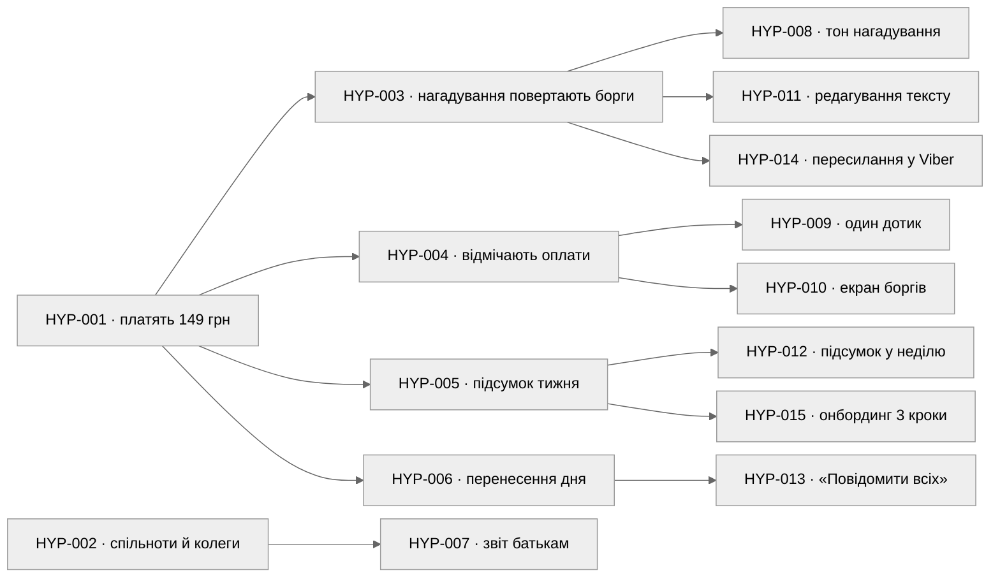
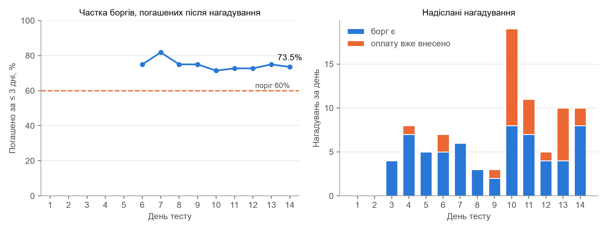
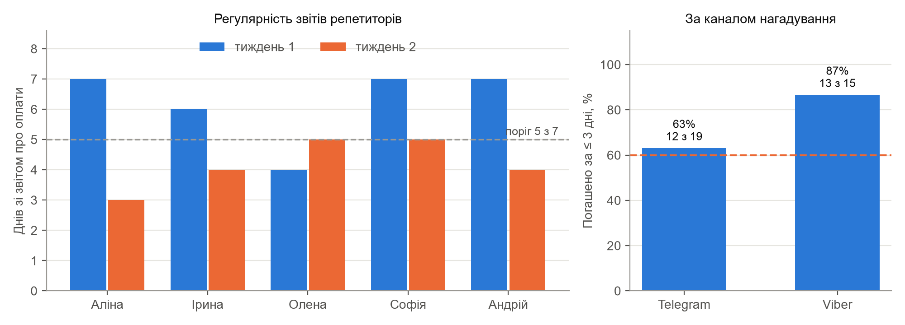

# Мета роботи

Навчитись формулювати продуктові гіпотези на трьох рівнях, обирати та будувати відповідний тип MVP, планувати і проводити валідаційні експерименти для перевірки гіпотез.

Робота продовжує практичні роботи № 1 і № 2 для продукту Classno – застосунку для обліку занять, оплат і нагадувань для приватних репетиторів. Гіпотези спираються на Job Statements, Pains і Gains персон Аліна (студентка-репетиторка, 8 учнів онлайн) та Ірина (вчителька англійської з приватною практикою, 22 учні), а також на рішення, обрані в матриці оцінки рішень: журнал оплат, підсумок тижня і нагадування про оплату від імені сервісу.

# 1. Дерево гіпотез

## 1.1. Структура дерева

Дерево побудовано за методологією Lean Startup [1] зверху вниз. Дві бізнес-гіпотези описують, чи готові репетитори платити за продукт і як вони про нього дізнаються. Продуктові гіпотези конкретизують, які функції створюють цю цінність, а функціональні – які UX-рішення змусять ці функції працювати. Стрілка на рисунку 1 означає, що нижня гіпотеза має сенс лише за умови, що підтвердиться верхня. Кожну гіпотезу показано під тією, від якої вона залежить найбільше.

Рисунок 1 – Дерево гіпотез Classno

## 1.2. Таблиця гіпотез

У колонці зв'язку Job – номер Job Statement, P – Pain із канвасу відповідної персони з практичної роботи № 2. Ризик оцінено за шкалою від 1 (є поведінкові докази) до 5 (лише думки з інтерв'ю).

Таблиця 1 – Дерево гіпотез Classno

| ID | Рівень | Формулювання гіпотези | JTBD / Pain | Ризик | Пріоритет |
| ------------- | ----------- | ------------------------------------ | --------------- | ---------- | --------------- |
| HYP-001 | Бізнес | Якщо ми створимо журнал оплат з нагадуваннями від імені сервісу для репетиторів з 6+ учнями, то щонайменше 30% активних користувачів платитимуть 149 грн/міс за тариф Pro | Job 2, Job 6; P2 Аліни, P1 Ірини | 5 | High |
| HYP-002 | Бізнес | Якщо ми поширюватимемо Classno через Telegram-спільноти репетиторів і рекомендації колег, то залучимо перших 200 репетиторів без платної реклами | Job 10; канали персон з ПР01 | 4 | High |
| HYP-003 | Продукт | Ми вважаємо, що репетитори доручать нагадування про оплату сервісу, щоб отримувати борги без особистих повідомлень, і щонайменше 60% прострочених оплат погашатимуться протягом 3 днів після нагадування | Job 2, Job 4; P2 Аліни | 5 | High |
| HYP-004 | Продукт | Ми вважаємо, що репетитори відмічатимуть оплати щонайменше 5 днів на тиждень, щоб бачити актуальні борги | Job 1; P1 Аліни | 4 | High |
| HYP-005 | Продукт | Ми вважаємо, що вчителі з 15+ учнями користуватимуться автоматичним підсумком тижня замість ручного зведення, і облік займатиме до 30 хв на тиждень | Job 6; P1 Ірини | 3 | Med |
| HYP-006 | Продукт | Ми вважаємо, що репетитори переноситимуть усі заняття дня однією дією з розсилкою, коли змінюється графік відключень | Job 8; P2 Ірини | 3 | Med |
| HYP-007 | Продукт | Ми вважаємо, що вчителі надсилатимуть батькам місячний звіт за шаблоном щонайменше раз на місяць | Job 7; P3 Ірини | 2 | Low |
| HYP-008 | Функція | Якщо нагадування підписане як повідомлення від Classno, помічника репетитора, і має нейтральний тон, то не більше 5% отримувачів відповідатимуть негативно | Job 4; Anxiety Аліни | 4 | High |
| HYP-009 | Функція | Якщо оплату можна відмітити одним дотиком «готівкою» чи «на картку» біля заняття, то репетитор відмітить щонайменше 80% занять того ж дня | Job 1, Job 6; P1 обох персон | 3 | High |
| HYP-010 | Функція | Якщо головний екран показує список боргів, відсортований за сумою, то репетитор відкриватиме застосунок щонайменше 4 рази на тиждень | Job 1; G1 Аліни | 3 | Med |
| HYP-011 | Функція | Якщо репетитор бачить і може змінити текст нагадування перед першим надсиланням, то щонайменше 70% репетиторів увімкнуть нагадування в перший тиждень | Job 2; Anxiety Аліни | 3 | Med |
| HYP-012 | Функція | Якщо підсумок тижня приходить у Telegram щонеділі о 18:00, то щонайменше 60% репетиторів відкриватимуть його в день отримання | Job 6; G2 Ірини | 2 | Med |
| HYP-013 | Функція | Якщо після перенесення дня з'являється кнопка «Повідомити всіх» з готовим текстом, то репетитор повідомить щонайменше 80% учнів за 5 хвилин | Job 8; P2 Ірини | 2 | Low |
| HYP-014 | Функція | Якщо нагадування можна переслати посиланням у Viber, то репетитори, чиї батьки у Viber, користуватимуться нагадуваннями так само часто, як у Telegram | Job 7; G7 Ірини | 3 | Low |
| HYP-015 | Функція | Якщо онбординг складається з 3 кроків без налаштувань, то щонайменше 80% вчителів 40+ завершать його без сторонньої допомоги | Job 9; P5 Ірини | 2 | Low |

Ризик 5 мають дві гіпотези, від яких залежить решта дерева: HYP-001 і HYP-003. Про обидві в інтерв'ю говорили всі учасники, але жодна не підтверджена поведінкою. Функціональні гіпотези мають нижчий ризик: вони стосуються конкретного інтерфейсу і перевіряються дешевше.

## 1.3. Ключові припущення (LOFAs)

Таблиця 2 – LOFA № 1 – Value Hypothesis

| Поле | Зміст |
| -------------------------- | ---------------------------------------------------------------------- |
| Формулювання | Ми вважаємо, що репетитори дійсно отримують цінність від Classno, коли нагадування про оплату надходять учням і батькам від імені сервісу: борги повертаються швидше, а репетитору не доводиться писати про гроші самому (HYP-003) |
| Чому це критично? | Нагадування від імені сервісу – головна відмінність Classno від конкурентів і основа UVP Аліни. Якщо учні ігнорують такі повідомлення або сприймають їх негативно, Classno стає ще одним журналом обліку, яких на ринку вже кілька, і причин переходити з нотаток і Excel не лишається |
| Спосіб перевірки | Concierge MVP: два тижні команда вручну веде облік оплат п'яти репетиторів і надсилає нагадування від імені Classno. Метрика – частка прострочених оплат, погашених протягом 3 днів після першого нагадування |
| Поточний рівень впевненості | 55%. Біль підтверджують 5 з 5 інтерв'ю і 61% респондентів опитування, але як учні реагують на нагадування від сервісу, досі невідомо |

Таблиця 3 – LOFA № 2 – Growth Hypothesis

| Поле | Зміст |
| -------------------------- | ---------------------------------------------------------------------- |
| Формулювання | Ми вважаємо, що нові користувачі дізнаватимуться про Classno через Telegram-спільноти репетиторів і рекомендації колег, тому що там уже шукають учнів і поради 79% репетиторів, а кожне нагадування з підписом Classno бачать батьки, серед яких є інші вчителі (HYP-002) |
| Чому це критично? | Ціна Pro – 149 грн/міс, тож платна реклама з вартістю залучення понад 300–400 грн не окупиться раніше ніж за кілька місяців. Без органічного каналу бізнес-модель SOM з практичної роботи № 1 не виконується |
| Спосіб перевірки | Лендінг з формою передреєстрації і публікації в трьох Telegram-спільнотах репетиторів, метрика – конверсія переходів у заявки. Додатковий сигнал під час Concierge MVP – кількість звернень від колег учасників |
| Поточний рівень впевненості | 35%. Учасників опитування знайдено саме в цих спільнотах, проте ніхто з них не рекомендував колегам жоден інструмент обліку |

Третє ризиковане припущення – готовність платити (HYP-001). Його не винесено окремою LOFA, бо воно має сенс лише після підтвердження цінності, але наприкінці Concierge-тесту учасникам запропоновано передплату.

# 2. Вибір типу MVP

## 2.1. Гіпотеза для першої перевірки

Першою перевіряється HYP-003 – Value LOFA з ризиком 5. Від неї залежать обидві бізнес-гіпотези: якщо нагадування від сервісу не повертають борги, платити за них ніхто не буде, а підпис Classno в повідомленнях не стане каналом зростання. Разом із нею той самий тест вимірює HYP-004 і HYP-008: без регулярних даних про оплати нагадування будуть помилковими, а від тону залежить, як їх сприймуть батьки.

Важливо, що HYP-003 – це питання поведінки третьої сторони: репетитор лише доручає нагадування, а реагують на нього учні та батьки. Тому MVP має доставляти справжні нагадування справжнім учням, і опитування чи прототип тут не підходять.

## 2.2. Порівняльна матриця типів MVP

Таблиця 4 – Порівняльна матриця типів MVP для HYP-003

| Тип MVP | Гіпотеза | Час | Інсайти | Надійність | Сума | Рекомендація |
| ----------------- | ------------- | --------- | ------------ | ---------------- | -------- | ------------------------- |
| Landing Page | 2 | 4 | 2 | 2 | 10 | Для HYP-002 |
| Smoke Test | 1 | 5 | 2 | 2 | 10 | Відхилити |
| Concierge MVP | 5 | 4 | 5 | 4 | 18 | Обрано |
| Wizard of Oz | 4 | 2 | 4 | 4 | 14 | Наступна ітерація |
| Figma Prototype | 2 | 2 | 3 | 2 | 9 | Для HYP-015 |
| Email Campaign | 1 | 5 | 2 | 2 | 10 | Відхилити |
| Pre-sell | 3 | 3 | 3 | 5 | 14 | Для HYP-001 |
| Explainer Video | 2 | 2 | 2 | 2 | 8 | Відхилити |

Колонки матриці: гіпотеза – наскільки тип MVP підходить для HYP-003, час – швидкість побудови, інсайти – глибина розуміння поведінки й мотивів, надійність – ризик хибного сигналу (5 – ризик низький). Усі оцінки за шкалою від 1 до 5, де 5 – найкраще.

Пояснення оцінок:

1. Landing Page, Explainer Video і Email Campaign показують інтерес репетитора, але нічого не кажуть про реакцію учнів, тому за придатністю отримали 1–2. Email до того ж не канал цієї аудиторії: репетитори працюють у Telegram і Viber.
2. Smoke Test потребує наявного продукту, у який можна додати кнопку, а Classno ще не існує.
3. Figma Prototype перевіряє зрозумілість екранів, тож придатний для HYP-015, але нагадування в ньому ніхто з учнів не отримає.
4. Pre-sell має найменший ризик хибного сигналу, бо гроші – найсильніший доказ, але перевіряє готовність платити, а не те, чи повертаються борги.
5. Wizard of Oz дає ту саму якість даних, що й Concierge, але потребує Telegram-бота як фасаду, а це 3–7 днів розробки. Приховувати ручну роботу на цьому етапі немає сенсу: репетитору важливий результат, а не інтерфейс.

## 2.3. Обґрунтування вибору

Таблиця 5 – Обґрунтування вибору MVP

| Поле | Зміст |
| ----------------------------- | ----------------------------------------------------------------------- |
| Обраний тип MVP | Concierge MVP. Команда вручну веде облік оплат п'яти репетиторів і надсилає нагадування учням від імені Classno. Це єдиний тип з матриці, що за 1–2 дні підготовки доставляє справжні нагадування справжнім учням і дає змогу поговорити з кожним репетитором про його досвід |
| Яку гіпотезу перевіряємо? | HYP-003: репетитори доручать нагадування про оплату сервісу, і щонайменше 60% прострочених оплат погашатимуться протягом 3 днів після нагадування. Разом із нею – HYP-004 і HYP-008, а на фінальному дзвінку – HYP-001 |
| Які дані отримаємо? | Частка прострочених оплат, погашених за 3 дні після першого нагадування; середній час від нагадування до оплати; кількість днів на тиждень, коли репетитор передав дані про оплати; частка помилкових і негативних відповідей; цитати з дзвінків зворотного зв'язку; відповідь на пропозицію передплати |
| Порогове значення успіху | MVP підтверджує гіпотезу, якщо частка прострочених оплат, погашених протягом 3 днів після першого нагадування, досягне 60% за 14 днів тесту |
| Альтернативний варіант | Wizard of Oz: Telegram-бот Classno, у якому репетитор відмічає оплати кнопками, а нагадування за ним надсилає оператор. За подвійних ресурсів він перевірив би одночасно цінність і те, чи відмічатимуть репетитори оплати без живої людини на зв'язку, на 10–15 учасниках |
| Що НЕ перевіряє цей MVP? | Канал зростання (HYP-002): учасників знайдено особисто. Масову готовність платити: п'ять осіб, які два тижні отримували безкоштовний сервіс, схильні погоджуватися. Функціональні гіпотези інтерфейсу (HYP-009, HYP-010, HYP-015): інтерфейсом слугує чат із командою |

# 3. Документація MVP: Concierge

## 3.1. Сервісний сценарій

Таблиця 6 – Service Script для Concierge MVP

| Поле | Зміст |
| ---------------------------- | ------------------------------------------------------------------------ |
| Що робить клієнт? | На старті надсилає список учнів, ціну заняття, розклад і контакт того, хто платить: учня або батьків. Погоджує текст нагадування. Щовечора до 21:00 пише в чат, хто сьогодні мав заняття і хто заплатив, або пересилає скриншот переказів |
| Що робить команда вручну? | Веде таблицю обліку для кожного репетитора: заняття, оплати, борги. Щоранку о 10:00 перевіряє борги: якщо заняття не оплачене два дні, надсилає нагадування від Classno, через три дні без оплати – повторне. Відповідає на повідомлення учнів і батьків. Щонеділі о 18:00 надсилає репетитору підсумок тижня. Кожну дію записує в журнал |
| Через які канали? | Telegram-акаунт Classno для репетиторів і учнів, Viber-номер Classno для батьків, які не користуються Telegram, Google Sheets для таблиць обліку і журналу, Google Meet для вступних і фінальних дзвінків |
| Який час відповіді? | Повідомлення репетитора обробляється протягом 2 годин з 10:00 до 22:00. Нагадування надсилаються раз на день о 10:00, підсумок тижня – щонеділі о 18:00 |
| Як виглядає готовий результат? | Репетитор не пише учням про гроші і в будь-який момент може запитати в чаті, хто скільки винен. Щонеділі отримує підсумок: заняття, оплати готівкою і на картку, борг по кожному учню |

Текст нагадування погоджено з кожним репетитором перед стартом. Після перших чотирьох днів його змінено: перша версія містила слово «заборгованість» і викликала дві різкі відповіді від учнів Аліни і одну від учня Андрія.

Таблиця 7 – Версії тексту нагадування

| Версія | Текст |
| ---------------- | ------------------------------------------------------------------------------ |
| 1, дні 1–4 | Добрий день! Це Classno – сервіс, через який Аліна веде облік занять. За вами заборгованість 700 грн за заняття у вівторок і четвер. Реквізити для оплати: … |
| 2, з 5-го дня | Добрий день! Це Classno, помічник Аліни з обліку занять. Нагадуємо про оплату за заняття у вівторок і четвер – 700 грн. Реквізити: … Якщо ви вже оплатили, просто напишіть, і ми все виправимо |

## 3.2. Учасники

Учасниць практичної роботи № 1 запрошено особисто, ще двох репетиторів знайдено в Telegram-спільноті репетиторів НМТ через пост із пропозицією безкоштовно вести облік оплат два тижні. На вступному дзвінку кожному пояснили, що сервіс поки працює вручну, і попросили попередити учнів чи батьків, що нагадування надходитимуть від Classno.

Таблиця 8 – Учасники Concierge MVP

| Ім'я | Вік | Що викладає | Учнів | Як платять | Хто платить і де | Звідки |
| ---------- | ------ | ------------------ | ---------- | --------------- | ----------------------- | ------------------ |
| Аліна | 20 | Математика, НМТ | 8 | Переказ | Учні, Telegram | Інтерв'ю ПР01 |
| Ірина | 43 | Англійська | 22 | Готівка, переказ | Батьки у Viber (16), учні в Telegram (6) | Інтерв'ю ПР01 |
| Олена | 36 | Фортепіано | 14 | Готівка, переказ | Батьки у Viber | Інтерв'ю ПР01 |
| Софія | 22 | Англійська для дорослих | 7 | Переказ | Учні, Telegram | Спільнота НМТ |
| Андрій | 24 | Фізика, НМТ | 9 | Переказ, частково готівка | Учні в Telegram, двоє батьків у Viber | Спільнота НМТ |

## 3.3. Перебіг тесту

1. Підготовка. На вступному дзвінку репетитор надсилав список учнів і погоджував текст нагадування. Таблиці обліку заповнювались за вечір до старту.
2. Щоденна робота. Команда звіряла повідомлення репетиторів з таблицею, о 10:00 надсилала нагадування, відповідала учням і батькам. На одного репетитора йшло в середньому 15–20 хвилин на день, на Ірину – до 40.
3. Зворотний зв'язок. Після першого і другого тижня з кожним репетитором проведено 10-хвилинну розмову: що було корисно, що незрозуміло, чи користувались би регулярно, скільки готові платити. Наприкінці другої розмови запропоновано продовжити сервіс на місяць за 149 грн з передплатою.
4. Журнал. Усі події – заняття, оплати, нагадування, відповіді, звіти репетиторів – записувались в окремий Log-файл з трьома аркушами: журнал подій, щоденник тестування і підсумки по репетиторах. Фрагмент журналу наведено в додатку А.

# 4. Картки валідаційних експериментів

## 4.1. Картки гіпотез

Для карток обрано п'ять гіпотез з найвищим пріоритетом: обидві бізнес-гіпотези, дві продуктові і функціональну гіпотезу про тон нагадувань. Формат картки відповідає Test Card з Testing Business Ideas [2]. Статус наведено за результатами тесту з розділу 5.

Таблиця 9 – Картка гіпотези № 1

| Поле | Зміст |
| -------------------------------- | -------------------------------------------------------------------- |
| ID гіпотези | HYP-003 |
| Рівень | Продукт |
| Формулювання «Ми вважаємо, що…» | Ми вважаємо, що репетитори доручать нагадування про оплату сервісу, щоб отримувати борги без особистих повідомлень. Ми перевіримо це через Concierge MVP. Якщо ми побачимо, що щонайменше 60% прострочених оплат погашено протягом 3 днів після нагадування, то підтвердимо, що нагадування від імені сервісу повертають гроші |
| Пов'язаний JTBD / Pain | Job 2 «отримати борг без особистого нагадування», Job 4 «почуватися спокійно щодо грошей»; Extreme Pain P2 Аліни «соромно нагадувати» |
| Метод перевірки | Concierge MVP, 5 репетиторів, 14 днів |
| Метрика успіху | Частка прострочених оплат, погашених протягом 3 днів після першого нагадування, ≥ 60% |
| Критерій підтвердження | Гіпотеза підтверджена, якщо з усіх боргів, перше нагадування за якими надіслано не пізніше 11-го дня, щонайменше 60% погашено протягом 3 днів |
| Ризик (1–5) | 5 |
| Пріоритет | High |
| Статус | Підтверджена |

Таблиця 10 – Картка гіпотези № 2

| Поле | Зміст |
| -------------------------------- | -------------------------------------------------------------------- |
| ID гіпотези | HYP-004 |
| Рівень | Продукт |
| Формулювання «Ми вважаємо, що…» | Ми вважаємо, що репетитори відмічатимуть оплати щонайменше 5 днів на тиждень, щоб бачити актуальні борги. Ми перевіримо це через щоденні звіти в чат Concierge MVP. Якщо 4 з 5 репетиторів звітуватимуть 5+ днів на тиждень обидва тижні, то підтвердимо, що ручна відмітка оплат не стане вузьким місцем продукту |
| Пов'язаний JTBD / Pain | Job 1 «одразу позначити, за які заняття заплатив учень»; Extreme Pain P1 Аліни «втрачає 1–2 оплати на місяць» |
| Метод перевірки | Concierge MVP: кількість днів, коли репетитор передав команді дані про оплати |
| Метрика успіху | Кількість днів зі звітом на тиждень, ≥ 5 з 7 |
| Критерій підтвердження | Гіпотеза підтверджена, якщо щонайменше 4 з 5 репетиторів звітують 5+ днів і в першому, і в другому тижні |
| Ризик (1–5) | 4 |
| Пріоритет | High |
| Статус | Спростована |

Таблиця 11 – Картка гіпотези № 3

| Поле | Зміст |
| -------------------------------- | -------------------------------------------------------------------- |
| ID гіпотези | HYP-008 |
| Рівень | Функція |
| Формулювання «Ми вважаємо, що…» | Ми вважаємо, що якщо нагадування підписане як повідомлення від Classno, помічника репетитора, і має нейтральний тон, то учні й батьки не сприйматимуть його як недовіру. Ми перевіримо це через відповіді на нагадування Concierge MVP. Якщо негативних відповідей буде не більше 5%, то підтвердимо, що нагадування від сервісу не шкодять стосункам репетитора з учнями |
| Пов'язаний JTBD / Pain | Job 4 «не відчувати сорому, ніби випрошую свої гроші»; Anxiety Аліни «якщо бот напише мамі якось не так, вийде ще гірше» |
| Метод перевірки | Concierge MVP: класифікація відповідей на кожне нагадування |
| Метрика успіху | Частка негативних відповідей від усіх надісланих нагадувань, ≤ 5% |
| Критерій підтвердження | Гіпотеза підтверджена, якщо негативних відповідей (невдоволення, питання «хто це пише», відмова отримувати повідомлення) не більше 5% від усіх нагадувань |
| Ризик (1–5) | 4 |
| Пріоритет | High |
| Статус | Спростована |

Таблиця 12 – Картка гіпотези № 4

| Поле | Зміст |
| -------------------------------- | -------------------------------------------------------------------- |
| ID гіпотези | HYP-001 |
| Рівень | Бізнес |
| Формулювання «Ми вважаємо, що…» | Ми вважаємо, що репетитори з 6+ учнями платитимуть 149 грн/міс за облік оплат з нагадуваннями від імені сервісу, тому що це менше за одне заняття, а повернутий борг окупає підписку. Ми перевіримо це пропозицією передплати наприкінці Concierge MVP. Якщо щонайменше 30% учасників внесуть передплату, то отримаємо перший сигнал готовності платити |
| Пов'язаний JTBD / Pain | Job 2, Job 6; Extreme Pain P2 Аліни і P1 Ірини |
| Метод перевірки | Пропозиція продовжити сервіс на місяць за 149 грн з передплатою на фінальному дзвінку; далі Pre-sell на лендінгу |
| Метрика успіху | Частка учасників з 6+ учнями, що внесли передплату, ≥ 30% |
| Критерій підтвердження | Гіпотеза підтверджена, якщо щонайменше 30% репетиторів з 6+ учнями внесуть передплату у вибірці щонайменше з 80 осіб |
| Ризик (1–5) | 5 |
| Пріоритет | High |
| Статус | Недостатньо даних |

Таблиця 13 – Картка гіпотези № 5

| Поле | Зміст |
| -------------------------------- | -------------------------------------------------------------------- |
| ID гіпотези | HYP-002 |
| Рівень | Бізнес |
| Формулювання «Ми вважаємо, що…» | Ми вважаємо, що репетитори дізнаватимуться про Classno з Telegram-спільнот і від колег, тому що там вони вже шукають учнів і поради. Ми перевіримо це через лендінг з передреєстрацією і пости в трьох спільнотах. Якщо щонайменше 8% переходів завершаться заявкою, то підтвердимо, що органічний канал здатний дати перших 200 користувачів |
| Пов'язаний JTBD / Pain | Job 10 «виглядати сучасною і надійною викладачкою»; канали персон з практичної роботи № 1 |
| Метод перевірки | Landing Page MVP з подією CTA_click і формою заявки; кількість звернень від колег учасників Concierge MVP як додатковий сигнал |
| Метрика успіху | Конверсія переходу зі спільнот у заявку, ≥ 8% |
| Критерій підтвердження | Гіпотеза підтверджена, якщо зі щонайменше 315 унікальних відвідувачів з Telegram-спільнот 8% залишать заявку |
| Ризик (1–5) | 4 |
| Пріоритет | High |
| Статус | Недостатньо даних |

## 4.2. Розрахунок вибірки

Мінімальний розмір вибірки для оцінки частки розраховано за формулою Кокрена [3]:

$$N = \frac{Z^2 \cdot p \cdot (1 - p)}{e^2},$$

де $Z = 1.96$ для рівня впевненості 95%, $p$ – очікувана частка, $e$ – допустима похибка.

Для лендінгу HYP-002 з очікуваною конверсією 8% і похибкою ±3 п.п.:

$$N = \frac{1.96^2 \cdot 0.08 \cdot 0.92}{0.03^2} = \frac{3.8416 \cdot 0.0736}{0.0009} \approx 315\text{ відвідувачів}.$$

Для Pre-sell HYP-001 з очікуваною часткою 30% і похибкою ±10 п.п. потрібно $N = 3.8416 \cdot 0.21 / 0.01 \approx 81$ репетитор, якому показано пропозицію.

Для HYP-003 одиниця вибірки – прострочена оплата, а не репетитор. За очікуваної частки 60% і похибки ±10 п.п. потрібно $N = 3.8416 \cdot 0.24 / 0.01 \approx 93$ борги. П'ять репетиторів за два тижні дають близько 35 боргів, тож Concierge MVP дає оцінку з похибкою близько ±15 п.п. Цього досить, щоб відрізнити «працює» від «не працює», але замало для точної цифри. Точнішу оцінку дасть наступна ітерація на 12–15 репетиторах.

Таблиця 14 – Параметри експериментів

| Параметр | Рекомендоване значення | У цій роботі |
| ---------------------------- | ------------------------------- | ------------------------------------ |
| Рівень значущості (α) | 0.05 | 0.05 для всіх розрахунків |
| Статистична потужність | 0.80 | 0.80 для наступної ітерації |
| Мінімальний виявлюваний ефект | 20% відносного покращення | 60% погашених боргів проти 30–40%, які погашаються без нагадувань за оцінкою репетиторів |
| Тривалість тесту | Мінімум 2 тижні | 14 днів, два повні тижні з вихідними |
| Вибірка для Landing Page | Мінімум 200 відвідувачів | 315 відвідувачів (HYP-002) |
| Вибірка для Concierge MVP | 3–5 клієнтів | 5 репетиторів, 60 учнів, 34 борги з повним вікном спостереження |

# 5. Результати тестування

## 5.1. Щоденник тестування

Головна метрика щоденника – частка боргів, погашених протягом 3 днів після першого нагадування. Вона рахується лише для боргів, за якими вже минуло 3 дні з нагадування, тому перші значення з'являються на 6-й день. Ціль – поріг 60%, дельту наведено в процентних пунктах відносно нього.

Таблиця 15 – Щоденник тестування

| Дата | Метрика | Ціль | Факт | Дельта | Нотатки / Спостереження |
| ----------- | --------------- | -------- | -------------- | ----------- | ----------------------------------------- |
| День 1 | Погашено за ≤ 3 дні | 60% | – | – | Таблиці заповнено, 4 з 5 репетиторів надіслали звіт увечері. Нагадувань ще немає: боргів старших за два дні не було |
| День 3 | Погашено за ≤ 3 дні | 60% | – | – | Перші 4 нагадування, 1 негативна відповідь від учня Аліни: «Я ж писав, що скину в п'ятницю» |
| День 5 | Погашено за ≤ 3 дні | 60% | – | – | 17 нагадувань, 3 негативні відповіді на першу версію тексту. Текст змінено на версію 2 |
| День 7 | Погашено за ≤ 3 дні | 60% | 81.8% (9 з 11) | +21.8 п.п. | 30 нагадувань. Перший підсумок тижня надіслано всім п'ятьом; Ірина звірила його з журналом – збіглося |
| День 10 | Погашено за ≤ 3 дні | 60% | 71.4% (15 з 21) | +11.4 п.п. | Аліна, Ірина й Андрій два дні після вихідних не надсилали звітів. 11 нагадувань за день пішли тим, хто вже заплатив: «Ми ж оплатили в понеділок» |
| День 12 | Погашено за ≤ 3 дні | 60% | 72.7% (16 з 22) | +12.7 п.п. | Помилкових нагадувань уже 20. Олена: готівку записує в зошит і пише команді ввечері, якщо згадає |
| День 14 | Погашено за ≤ 3 дні | 60% | 73.5% (25 з 34) | +13.5 п.п. | 91 нагадування, з них 28 помилкових. Фінальні дзвінки, пропозиція передплати |
| Фінал | Погашено за ≤ 3 дні | 60% | 73.5% | +13.5 п.п. | Середній час від нагадування до оплати – 1.9 дня. 9 боргів на кінець тесту не погашено, з них 7 відкрито в останні три дні |

Динаміку метрик за даними журналу наведено на рисунках 2 і 3.

{width=16.5cm}

Рисунок 2 – Частка погашених боргів і надіслані нагадування за днями тесту

{width=16.5cm}

Рисунок 3 – Регулярність звітів репетиторів і результат нагадувань за каналом

Таблиця 16 – Підсумки по репетиторах

| Репетитор | Нагадувань | Погашено за ≤ 3 дні | Днів зі звітом, тиждень 1 / 2 | Помилкових нагадувань | Негативних відповідей |
| ----------------- | ---------------- | ---------------- | ------------------ | ----------------- | ---------------- |
| Аліна | 22 | 4 з 8 | 7 / 3 | 4 | 3 |
| Ірина | 18 | 4 з 6 | 6 / 4 | 9 | 2 |
| Олена | 24 | 8 з 9 | 4 / 5 | 8 | 2 |
| Софія | 14 | 5 з 6 | 7 / 5 | 1 | 0 |
| Андрій | 13 | 4 з 5 | 7 / 4 | 6 | 1 |
| Разом | 91 | 25 з 34 | 6.2 / 4.2 в середньому | 28 | 8 |

## 5.2. Аналіз гіпотез

Таблиця 17 – Результати гіпотези HYP-003: нагадування від сервісу повертають борги

| Поле | Зміст |
| ---------------------------- | ------------------------------------------------------------------------ |
| Метрика успіху (план) | Частка прострочених оплат, погашених протягом 3 днів після першого нагадування, ≥ 60% |
| Фактичний результат | 73.5%: 25 з 34 боргів. 95% довірчий інтервал – від 58.7% до 88.3% |
| Статус | Підтверджена |
| Ключові кількісні дані | Середній час від нагадування до оплати – 1.9 дня. Повторне нагадування знадобилось у 19 випадках. Батьки, яким нагадування надходили у Viber, погасили 13 з 15 боргів (87%), учні в Telegram – 12 з 19 (63%). Найнижчий результат в Аліни – 4 з 8: її учні – підлітки, які платять самі |
| Ключові якісні інсайти | «Вперше за рік я нікому не писала про гроші» (Аліна). «За два тижні мені віддали два старі борги, про які я вже й забув» (Андрій). «Мама Каті сказала, що їй так навіть зручніше – не ніяково самій питати, скільки винні» (Олена). Софія: «Мої учні дорослі, я й сама могла б їм написати, мені не соромно» – для неї біль P2 слабкий |
| Що змінили б у наступній ітерації? | Рахувати метрику окремо для боргів учнів і батьків з першого дня. Для учнів-підлітків тестувати копію нагадування батькам після другого нагадування. Збільшити вибірку до 90+ боргів, щоб нижня межа інтервалу була вищою за поріг |

Таблиця 18 – Результати гіпотези HYP-004: репетитори регулярно відмічають оплати

| Поле | Зміст |
| ---------------------------- | ------------------------------------------------------------------------ |
| Метрика успіху (план) | 4 з 5 репетиторів звітують про оплати щонайменше 5 днів на тиждень обидва тижні |
| Фактичний результат | Тиждень 1 – 4 з 5 репетиторів, тиждень 2 – 2 з 5 |
| Статус | Спростована |
| Ключові кількісні дані | У середньому 6.2 дня зі звітом у першому тижні і 4.2 – у другому. Найбільше падіння в Аліни: з 7 до 3 днів. Через пропущені звіти 28 з 91 нагадування (31%) пішли тим, хто вже заплатив; 25 з них – у другому тижні |
| Ключові якісні інсайти | «Звітувати щовечора – це та сама рутина, тільки тепер вам. На парах я про це забуваю» (Аліна). Олена записує готівку в зошит і переносить у чат, коли згадає. Ірина звітувала регулярніше в дні, коли була вдома з ноутбуком |
| Що змінили б у наступній ітерації? | Не чекати звіту від репетитора, а щовечора самим питати «Хто сьогодні заплатив?» зі списком учнів дня. Не надсилати нагадування, якщо від репетитора не було даних понад два дні. Для переказів – перевірити, чи погодяться репетитори пересилати сповіщення банку |

Таблиця 19 – Результати гіпотези HYP-008: нейтральний тон нагадування

| Поле | Зміст |
| ---------------------------- | ------------------------------------------------------------------------ |
| Метрика успіху (план) | Не більше 5% негативних відповідей від усіх надісланих нагадувань |
| Фактичний результат | 8 негативних відповідей на 91 нагадування – 8.8% |
| Статус | Спростована |
| Ключові кількісні дані | На нагадування про справжні борги – 3 негативні відповіді з 63 (4.8%), усі в перші 4 дні на першу версію тексту. Після зміни тексту негативних відповідей на справжні борги не було. Решта 5 негативних відповідей – на помилкові нагадування тим, хто вже заплатив |
| Ключові якісні інсайти | «А чому мені пише якийсь сервіс, а не Аліна?» – учень Аліни на першу версію тексту. «Ми віддали гроші Олені Петрівні в руки, навіщо це повідомлення?» – мати учениці Олени після помилкового нагадування. Двоє батьків учнів Ірини подякували за нагадування |
| Що змінили б у наступній ітерації? | Окремо міряти реакцію на тон і точність даних: сам тон після правки працює, а невдоволення викликають помилки обліку. Залишити в тексті фразу «Якщо ви вже оплатили, просто напишіть»: на неї відповіли спокійно 23 з 28 отримувачів помилкових нагадувань |

Таблиця 20 – Результати гіпотези HYP-001: готовність платити 149 грн/міс

| Поле | Зміст |
| ---------------------------- | ------------------------------------------------------------------------ |
| Метрика успіху (план) | Щонайменше 30% репетиторів з 6+ учнями вносять передплату за місяць |
| Фактичний результат | Передплату 149 грн внесли 3 з 5: Ірина, Олена й Андрій |
| Статус | Недостатньо даних |
| Ключові кількісні дані | 60% у вибірці з 5 осіб. Троє учасників знайомі з автором з інтерв'ю і два тижні отримували сервіс безкоштовно, тому їхня згода частково може бути вдячністю. Для висновку потрібно щонайменше 81 репетитор |
| Ключові якісні інсайти | «Сто п'ятдесят за те, що мені не треба писати батькам, – нормально» (Олена). «Гривень сто я б дала, але зараз, чесно, не готова» (Аліна; та сама сума, що й в інтерв'ю практичної роботи № 1). Платити погодились репетитори, у яких платять батьки або учнів більше 8 |
| Що змінили б у наступній ітерації? | Pre-sell на лендінгу для репетиторів, не знайомих з командою. Показувати два варіанти ціни – 99 і 149 грн – і розділити відповіді за тим, хто платить: учні чи батьки |

Таблиця 21 – Результати гіпотези HYP-002: канал зростання через спільноти й колег

| Поле | Зміст |
| ---------------------------- | ------------------------------------------------------------------------ |
| Метрика успіху (план) | Конверсія переходів зі спільнот у заявку на лендінгу ≥ 8% |
| Фактичний результат | Лендінг у цій ітерації не запускався. Під час тесту надійшло 3 звернення від нових репетиторів |
| Статус | Недостатньо даних |
| Ключові кількісні дані | Два з трьох звернень надійшли від людей, які побачили нагадування Classno як батьки: колега Олени з музичної школи і мама учня Андрія, яка сама репетиторка. Третє – колега Ірини з ліцею, якій Ірина розповіла про підсумок тижня |
| Ключові якісні інсайти | «Мені переслали ваше нагадування, а можна і мені так?» – колега Олени. Підпис Classno в нагадуванні працює як реклама серед батьків, частина з яких сама викладає |
| Що змінили б у наступній ітерації? | Запустити лендінг з UTM-мітками для кожної спільноти і окремою міткою для посилання в підписі нагадування, набрати 315 відвідувачів |

# 6. Фінальне рішення

Дані тесту зіставлено з ознаками рішень Persevere і Pivot.

Таблиця 22 – Ознаки для рішення Pivot чи Persevere

| Ознака | Результат Concierge MVP | На користь |
| ------------------------------ | ---------------------------------------------- | ------------------------ |
| Метрика досягла порогу | 73.5% проти 60% для HYP-003 | Persevere |
| Користувачі повертаються | Усі 5 репетиторів пройшли обидва тижні, 3 з 5 заплатили за продовження | Persevere |
| Якісний фідбек підтверджує цінність | 4 з 5 назвали нагадування найкориснішою частиною сервісу, Софія – підсумок тижня | Persevere |
| Органічні рекомендації | 3 звернення від нових репетиторів за два тижні без жодної реклами | Persevere |
| Готовність платити | 3 з 5, вибірка замала | Невизначено |
| Використовують не так, як очікували | Регулярно звітувати про оплати репетитори не готові: у другому тижні 2 з 5 | Змінити механізм |
| Знаходять іншу ЦА | Найкращий результат там, де платять батьки (87% проти 63%), а основна персона Аліна має найнижчий – 4 з 8 | Стежити за сегментом |

Цінність нагадувань від імені сервісу підтверджена, тому напрям продукту зберігається. Спростовано механізм збору даних: розрахунок на те, що репетитор сам щодня відмічає оплати, не працює вже з другого тижня, і саме це зробило частину нагадувань помилковими. Це вимагає змінити функцію, а не продукт.

Окремий сигнал стосується сегмента. Найсильніший ефект і готовність платити показали вчителі, чиї учні – діти, а платять батьки (Ірина, Олена). Для основної персони Аліни ефект найслабший. Двох тижнів і 34 боргів замало, щоб змінювати основну персону, тому наступна ітерація має перевірити цю різницю на більшій вибірці. Якщо вона підтвердиться, наступним кроком буде Customer Segment Pivot на вчителів з батьками-платниками.

Таблиця 23 – Фінальне рішення

| Поле | Зміст |
| ------------------------------ | ---------------------------------------------------------------------- |
| Рішення | Persevere |
| Якщо Persevere: наступна гіпотеза | HYP-004 у новому формулюванні: якщо щовечора бот сам питає «Хто сьогодні заплатив?» і показує список учнів дня з кнопками, то щонайменше 4 з 5 репетиторів відмічатимуть оплати 5+ днів на тиждень протягом 3 тижнів, а частка помилкових нагадувань буде нижчою за 5%. Наступний MVP – Wizard of Oz: Telegram-бот з кнопками відмітки, за яким нагадування надсилає оператор, 12–15 репетиторів, з них щонайменше половина з батьками-платниками. Паралельно – лендінг з Pre-sell для HYP-001 і HYP-002 |
| Якщо Pivot: тип Pivot | Не застосовується. Кандидат на наступну ітерацію – Customer Segment Pivot, якщо різниця між батьками й учнями підтвердиться |
| Якщо Pivot: що зберігаємо | Не застосовується. За можливого Pivot зберігаються текст нагадування версії 2, сервісний сценарій і журнал з 91 нагадування як базовий рівень |
| Якщо Pivot: нова гіпотеза | Не застосовується. Можливе формулювання: вчителі з 10+ учнями-дітьми платитимуть 149 грн/міс за нагадування батькам у Viber і Telegram від імені сервісу |
| Що б ви зробили інакше? | 1. Міряти частку помилкових нагадувань з першого дня і заборонити нагадування без свіжих даних від репетитора – тоді 25 помилкових нагадувань другого тижня можна було б уникнути. 2. Перед стартом перевірити текст нагадування на 2–3 учнях: перша версія за чотири дні дала всі три негативні відповіді на справжні борги. 3. Закласти в картку експерименту поділ за тим, хто платить – учень чи батьки: різницю виявлено вже після тесту, і на 15 боргах у Viber вона лише вказує напрям |

# Висновки

Робота перевела бачення Classno з рівня інтерв'ю на рівень поведінки. Із 15 гіпотез дерева перевірено п'ять ключових, і результати змінили пріоритети продукту.

1. Головна ціннісна гіпотеза підтвердилась: 73.5% боргів погашено протягом 3 днів після нагадування від імені сервісу, і репетиторам не довелося самим писати учням про гроші. Нагадування від Classno лишаються ядром продукту і його UVP.
2. Найслабшим місцем виявилось те, що в практичній роботі № 2 здавалось найпростішим, – ручна відмітка оплат. У другому тижні регулярно звітували лише 2 з 5 репетиторів, і через це 31% нагадувань були помилковими. Невдоволення батьків спричиняв саме помилковий облік, тоді як до тону після правки тексту претензій не було. Тому наступна ітерація перевіряє механізм збору даних, а не нагадування.
3. Тест показав можливий зсув цільової аудиторії: нагадування батькам у Viber працюють краще, ніж учням у Telegram, і платити погодились саме вчителі з батьками-платниками. Інтеграція з Viber, яку в практичній роботі № 2 віднесено до backlog, може виявитись частиною MVP.
4. Concierge MVP за п'ять днів підготовки дав відповідь на ризиковану гіпотезу і якісні пояснення до кожної цифри. Водночас вибірка з 34 боргів дає похибку ±15 п.п., тож висновки потребують підтвердження на 12–15 репетиторах у Wizard of Oz MVP.

# Список джерел

1. Ries E. The Lean Startup: How Today's Entrepreneurs Use Continuous Innovation to Create Radically Successful Businesses. New York : Crown Business, 2011. 336 p. URL: https://theleanstartup.com/book (дата звернення: 17.10.2026).
2. Bland D. J., Osterwalder A. Testing Business Ideas: A Field Guide for Rapid Experimentation. Hoboken : Wiley, 2019. 352 p. URL: https://www.strategyzer.com/library/testing-business-ideas-book (дата звернення: 17.10.2026).
3. Cochran W. G. Sampling Techniques. 3rd ed. New York : John Wiley & Sons, 1977. 428 p.

# Додаток А. Фрагмент журналу Concierge MVP

Журнал вівся по кожному репетитору окремо. Нижче – усі записи журналу Ірини за 10-й день тесту, коли після двох днів без звітів більшість нагадувань виявились помилковими.

Таблиця А.1 – Журнал подій Ірини, день 10

| День | Учень | Подія | Канал | Сума, грн | Примітка |
| ------- | -------- | -------------------------------- | ------------- | ---------- | ------------------------------ |
| 10 | І04 | нагадування, оплату вже внесено | Viber | 350 | оплату не передано |
| 10 | І04 | негативна відповідь | Viber | – | – |
| 10 | І06 | нагадування, оплату вже внесено | Viber | 400 | оплату не передано |
| 10 | І06 | відповідь «вже оплатили» | Viber | – | – |
| 10 | І07 | нагадування, оплату вже внесено | Viber | 300 | оплату не передано |
| 10 | І07 | відповідь «вже оплатили» | Viber | – | – |
| 10 | І08 | нагадування | Viber | 350 | – |
| 10 | І09 | нагадування, оплату вже внесено | Viber | 350 | оплату не передано |
| 10 | І09 | відповідь «вже оплатили» | Viber | – | – |
| 10 | І11 | нагадування | Viber | 350 | – |
| 10 | І17 | нагадування, оплату вже внесено | Telegram | 400 | оплату не передано |
| 10 | І17 | відповідь «вже оплатили» | Telegram | – | – |
| 10 | І19 | нагадування, оплату вже внесено | Telegram | 800 | оплату не передано |
| 10 | І19 | відповідь «вже оплатили» | Telegram | – | – |
| 10 | І20 | нагадування, оплату вже внесено | Telegram | 350 | оплату не передано |
| 10 | І20 | відповідь «вже оплатили» | Telegram | – | – |
| 10 | І02 | заняття | – | 400 | – |
| 10 | І02 | оплата | – | 400 | готівка |
| 10 | І07 | заняття | – | 300 | – |
| 10 | І07 | оплата | – | 300 | готівка |
| 10 | І08 | заняття | – | 350 | – |
| 10 | І11 | заняття | – | 350 | – |
| 10 | І11 | оплата | – | 700 | після нагадування |
| 10 | І13 | заняття | – | 300 | – |
| 10 | І13 | оплата | – | 300 | готівка |
| 10 | І16 | заняття | – | 350 | – |
| 10 | І16 | оплата | – | 350 | готівка |
| 10 | І22 | заняття | – | 400 | – |
| 10 | І22 | оплата | – | 400 | готівка |
| 10 | – | звіт репетитора | Telegram | – | – |
