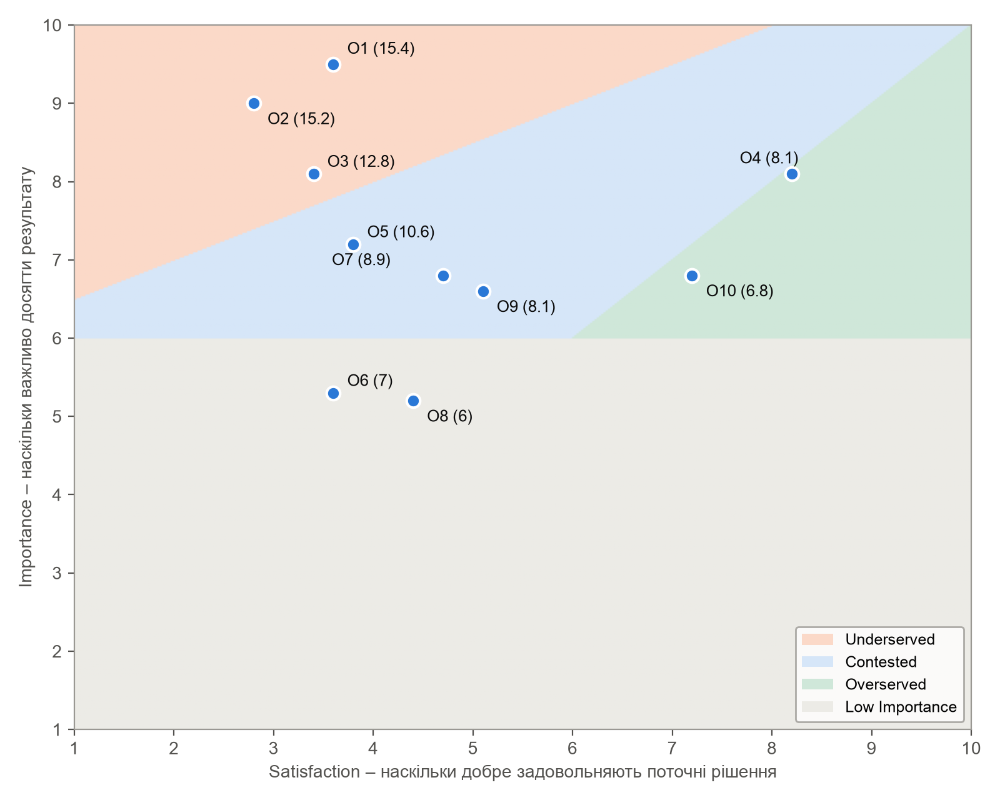
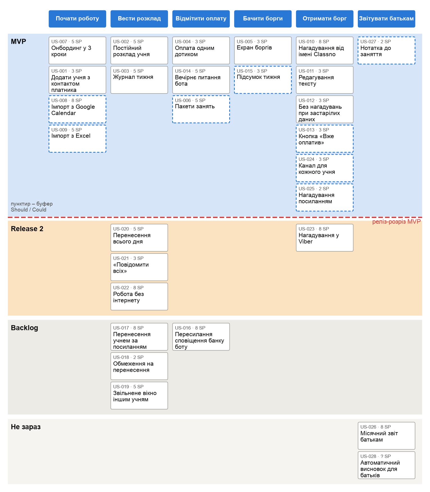
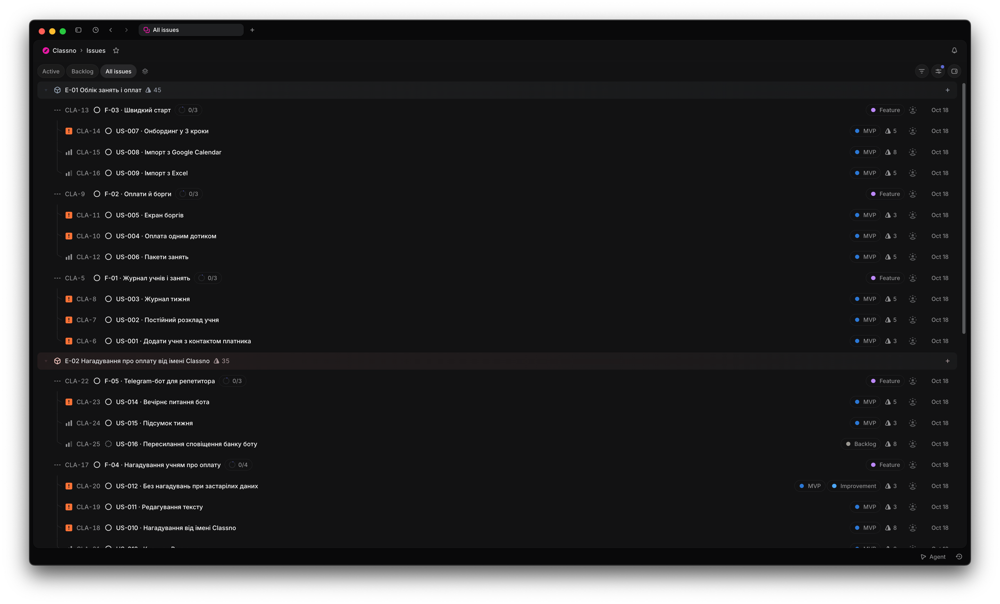
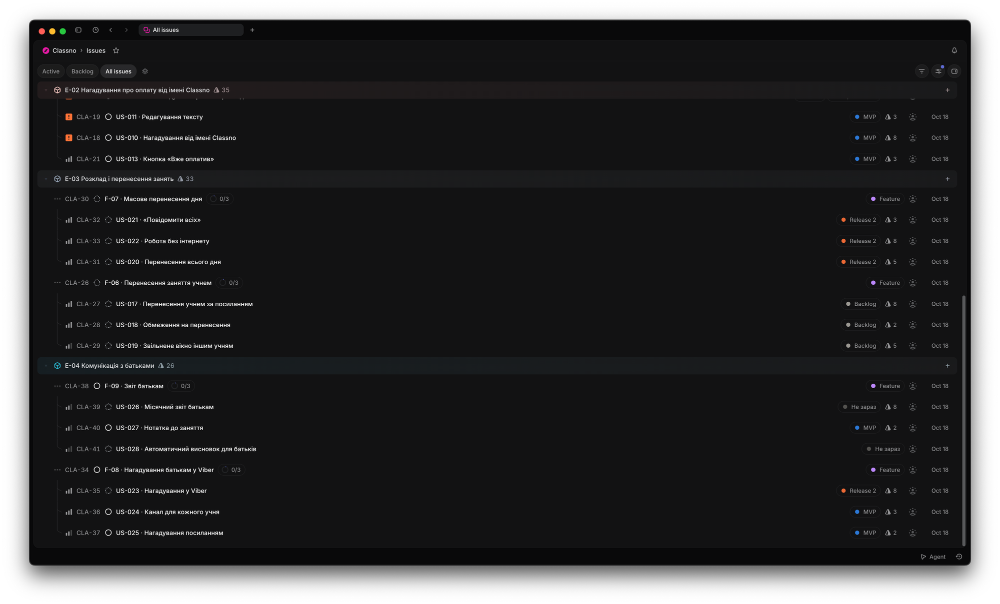

# Мета роботи

Сформувати практичні навички написання User Stories з коректними Acceptance Criteria, побудови ієрархічного беклогу та застосування кількісних і якісних методів пріоритизації.

Беклог побудовано для Classno – застосунку для обліку занять, оплат і нагадувань для приватних репетиторів. Він спирається на Job Statements і канваси персон Аліна та Ірина з практичної роботи № 2 і на результати Concierge MVP з практичної роботи № 3. Цей тест підтвердив цінність нагадувань від імені сервісу, але показав, що репетитори не відмічають оплати регулярно, а батьки у Viber платять швидше за учнів у Telegram.

# 1. Ієрархія беклогу

## 1.1. Epics

Чотири Epic відповідають ключовим групам JTBD з практичної роботи № 2. Два перші закривають Extreme Pains обох персон, пов'язані з грошима, і тому мають пріоритет High.

Таблиця 1 – Epics

<!-- gen:epics -->
| Epic ID | Назва Epic | Пов'язаний JTBD | Business Value | Пріоритет |
| -------- | ----------------- | -------------------------------- | --------------------------- | ---------------- |
| E-01 | Облік занять і оплат | Job 1 (Аліна): одразу позначити, за які заняття заплатив учень, щоб знати, хто винен. Job 6 (Ірина): бачити готовий підсумок оплат готівкою і на картку, щоб не витрачати на це вечір неділі | Activation Rate: частка нових репетиторів, які за 7 днів внесли всіх учнів і відмітили першу оплату | High |
| E-02 | Нагадування про оплату від імені Classno | Job 2 (Аліна): отримати борг без особистого нагадування. Job 4 (Аліна): не відчувати сорому, ніби випрошую свої ж гроші | Частка прострочених оплат, погашених за 3 дні після нагадування (73.5% у Concierge MVP), і W4 Retention | High |
| E-03 | Розклад і перенесення занять | Job 3 (Аліна): не втратити дохід, коли учень переносить заняття в останній момент. Job 8 (Ірина): швидко перебудувати розклад після зміни графіка відключень | Частка звільнених слотів, які вдалося заповнити, і час на перебудову розкладу | Med |
| E-04 | Комунікація з батьками | Job 7 (Ірина): за кілька хвилин надіслати батькам зрозумілий звіт. Gain G7 Ірини: нагадування приходять батькам у Viber | Конверсія в тариф Pro серед вчителів з 10+ учнями-дітьми | Low |
<!-- /gen:epics -->

## 1.2. Features

Кожна Feature має самостійну цінність, яку можна показати окремо: наприклад, Telegram-бот для репетитора працює й без самостійного перенесення занять. Оцінку Feature отримано як суму Story Points її Stories.

Таблиця 2 – Features

<!-- gen:features -->
| Feature ID | Назва Feature | Epic | User Value | Stories | SP |
| ----------- | -------------------- | ------- | ---------------------------------------- | ---------- | -------- |
| F-01 | Журнал учнів і занять | E-01 | Розклад і заняття всіх учнів в одному місці замість календаря й нотаток | 3 | 13 |
| F-02 | Оплати й борги | E-01 | Оплата прив'язана до заняття, борг рахується сам | 3 | 11 |
| F-03 | Швидкий старт | E-01 | Почати вести облік у перший вечір без сторонньої допомоги | 3 | 18 |
| F-04 | Нагадування учням про оплату | E-02 | Борги повертаються без особистих повідомлень репетитора | 4 | 17 |
| F-05 | Telegram-бот для репетитора | E-02 | Відмітити оплати й отримати підсумок, не відкриваючи застосунок | 3 | 16 |
| F-06 | Перенесення заняття учнем | E-03 | Учень сам переносить заняття на вільний слот | 3 | 15 |
| F-07 | Масове перенесення дня | E-03 | Перебудувати день занять після зміни графіка відключень за хвилину | 3 | 16 |
| F-08 | Нагадування батькам у Viber | E-04 | Нагадування доходять до батьків у тому месенджері, який вони читають | 3 | 13 |
| F-09 | Звіт батькам | E-04 | Місячний звіт про відвідуваність за 2 хвилини | 3 | 10 + ? |
<!-- /gen:features -->

## 1.3. Definition of Done

Definition of Done однаковий для всіх Stories і доповнює їхні Acceptance Criteria вимогами до якості. Story вважається завершеною, коли виконано всі пункти:

<!-- gen:dod -->
1. Код пройшов code review щонайменше одного розробника.
2. Unit-тести написані й проходять, покриття логіки розрахунку боргів і нагадувань – щонайменше 80%.
3. QA перевірив Story на тестовому середовищі в Android-застосунку, веб-версії і Telegram-боті, якщо Story їх зачіпає.
4. Немає відкритих критичних і high-priority багів.
5. Story задеплоєна на staging і перевірена на тестовому воркспейсі з 20+ учнями.
6. Додано аналітичні події для ключової дії Story.
7. Тексти інтерфейсу й повідомлень українською пройшли вичитку.
8. Головний екран і журнал відкриваються за менш ніж 2 с на 3G.
9. Product Owner підтвердив виконання всіх AC.
<!-- /gen:dod -->

## 1.4. User Stories

Беклог містить 28 User Stories за шаблоном Майка Коена [1]. Story Points оцінено за шкалою Фібоначчі відносно еталонної Story US-004 «Оплата одним дотиком» (3 SP): Stories з інтеграціями зовнішніх сервісів отримали 8 SP, а US-028 з генерацією тексту – «?», бо її невизначеність не дає оцінити обсяг. Acceptance Criteria записано у форматі Given-When-Then; щонайменше один критерій кожної Story описує edge case або помилку. Перші п'ять Stories мають розширені AC і нотатки із залежностями.

<!-- gen:stories -->
Таблиця 3 – US-001 «Додати учня з контактом платника»

| Поле | Зміст |
| -------------------------- | -------------------------------------------------------------------------- |
| ID | US-001 |
| Feature | F-01 «Журнал учнів і занять» |
| User Story | Як Аліна, я хочу додати учня з ціною заняття і контактом того, хто платить (учень або батьки), щоб оплати й нагадування стосувались правильної людини |
| Тип | Нова функція |
| Пов'язаний JTBD або Pain | Job 1 (Аліна): «Коли учень скидає оплату на картку, я хочу одразу позначити, за які заняття він заплатив…»; Pain P4 Аліни «все в різних місцях» |
| Story Points | 3 |
| Пріоритет (MoSCoW) | Must Have. Без картки учня неможливі ні облік оплат, ні нагадування – реліз без неї скасовується |
| Acceptance Criteria #1 | Given репетитор на екрані «Новий учень», When вводить ім'я, ціну заняття і обирає «Платить учень» з Telegram-нікнеймом, Then учень з'являється в журналі, а ціна підставляється в усі його майбутні заняття |
| Acceptance Criteria #2 | Given репетитор обрав «Платять батьки», When зберігає учня без контакту батьків, Then учень зберігається, біля нього з'являється позначка «Немає контакту для нагадувань», а нагадування для нього вимкнені |
| Acceptance Criteria #3 | Given в журналі вже є учень «Даня К.», When репетитор додає ще одного учня з таким самим ім'ям, Then застосунок попереджає про збіг і пропонує додати уточнення до імені, але не забороняє збереження |
| Acceptance Criteria #4 | Given репетитор вводить ціну 0 або від'ємну, When натискає «Зберегти», Then поле ціни підсвічується з підказкою «Вкажіть ціну заняття більше 0», учень не зберігається |
| Definition of Done | Загальний DoD команди (підрозділ 1.3) |
| Нотатки / Обмеження / Залежності | Контакт – Telegram-нікнейм або номер телефону для Viber (Viber – після F-08). Ціна може змінюватись: зміна діє лише на майбутні заняття, минулі борги не перераховуються. Безкоштовний тариф – до 5 учнів, шостий учень відкриває пропозицію Pro. Залежність: модель даних учня потрібна для US-002, US-004, US-010 |

Таблиця 4 – US-002 «Постійний розклад учня»

| Поле | Зміст |
| -------------------------- | -------------------------------------------------------------------------- |
| ID | US-002 |
| Feature | F-01 «Журнал учнів і занять» |
| User Story | Як Ірина, я хочу задати постійний розклад учня – дні тижня й час, щоб заняття на тиждень з'являлись у журналі самі |
| Тип | Нова функція |
| Пов'язаний JTBD або Pain | Job 6 (Ірина): «Коли наприкінці тижня я зводжу оплати… я хочу бачити вже готовий підсумок по кожному учню…»; Pain P1 Ірини «вечір неділі з журналом і калькулятором» |
| Story Points | 5 |
| Пріоритет (MoSCoW) | Must Have. Без розкладу заняття доводиться вносити вручну щоразу, і борг не з'являється автоматично – ключова обіцянка UVP не виконується |
| Acceptance Criteria #1 | Given учень без розкладу, When репетитор обирає вівторок і четвер о 16:00, Then у журналі з'являються заняття на поточний і наступні 4 тижні |
| Acceptance Criteria #2 | Given учень має розклад вівторок 16:00, When репетитор змінює його на середу 17:00 з поточного тижня, Then майбутні заняття переносяться на середу, а вже проведені заняття і їхні оплати не змінюються |
| Acceptance Criteria #3 | Given два учні мають заняття в той самий час, When репетитор зберігає розклад другого учня, Then застосунок показує попередження про накладку, але дозволяє зберегти – групові заняття можливі |
| Acceptance Criteria #4 | Given репетитор видаляє розклад учня, у якого є неоплачені заняття, When підтверджує видалення, Then майбутні заняття зникають, а неоплачені минулі лишаються в журналі й у боргах |
| Definition of Done | Загальний DoD команди (підрозділ 1.3) |
| Нотатки / Обмеження / Залежності | Часовий пояс – пристрою репетитора. Разове заняття поза розкладом додається окремою дією. Залежність від US-001. Обмеження: генерувати заняття на 4 тижні вперед, щоб не роздувати базу. UX: вибір днів чипами, а не випадним списком – Ірина в інтерв'ю скаржилась на «стільки кнопок» |

Таблиця 5 – US-003 «Журнал тижня»

| Поле | Зміст |
| -------------------------- | -------------------------------------------------------------------------- |
| ID | US-003 |
| Feature | F-01 «Журнал учнів і занять» |
| User Story | Як Аліна, я хочу бачити журнал тижня, де рядок – учень, а клітинка – заняття, щоб одразу бачити, які заняття відбулись і які оплачено |
| Тип | Нова функція |
| Пов'язаний JTBD або Pain | Job 1 (Аліна); Pain P4 Аліни «Розклад у календарі, оплати в нотатках, домашки в телеграмі – все в різних місцях» |
| Story Points | 5 |
| Пріоритет (MoSCoW) | Must Have. Журнал – основний робочий екран, на якому відмічаються оплати; без нього US-004 нікуди вбудувати |
| Acceptance Criteria #1 | Given репетитор має 8 учнів із заняттями цього тижня, When відкриває вкладку «Журнал», Then бачить 8 рядків, а клітинки показують статус кожного заняття: заплановане, проведене без оплати, оплачене |
| Acceptance Criteria #2 | Given репетитор переглядає поточний тиждень, When гортає вліво, Then відкривається попередній тиждень зі збереженими статусами |
| Acceptance Criteria #3 | Given у репетитора ще немає жодного учня, When відкриває журнал, Then бачить порожній стан із кнопкою «Додати першого учня» |
| Acceptance Criteria #4 | Given немає з'єднання з інтернетом, When репетитор відкриває журнал, Then бачить останню збережену версію з позначкою «Немає зв'язку, дані на …» |
| Definition of Done | Загальний DoD команди (підрозділ 1.3) |
| Нотатки / Обмеження / Залежності | Екран схожий на паперовий журнал – це знімає Habit Ірини «журнал веду двадцять років». На телефоні показується тиждень, на вебі – два. Статуси розрізняються не лише кольором, а й іконкою. Залежність від US-002. Офлайн тут – лише перегляд кешу; повноцінний офлайн-режим – US-022 |

Таблиця 6 – US-004 «Оплата одним дотиком»

| Поле | Зміст |
| -------------------------- | -------------------------------------------------------------------------- |
| ID | US-004 |
| Feature | F-02 «Оплати й борги» |
| User Story | Як Ірина, я хочу відмітити оплату одним дотиком «готівкою» чи «на картку» біля заняття, щоб не зводити оплати вручну в неділю |
| Тип | Нова функція |
| Пов'язаний JTBD або Pain | Job 6 (Ірина): «…бачити вже готовий підсумок по кожному учню, щоб не витрачати на це вечір неділі»; Pain P1 Ірини; Pain P1 Аліни «втрачає 1–2 оплати на місяць» |
| Story Points | 3 |
| Пріоритет (MoSCoW) | Must Have. Це центральна дія продукту: 61% опитаних назвали облік оплат і боргів найважливішою функцією |
| Acceptance Criteria #1 | Given заняття проведене і не оплачене, When репетитор натискає на клітинку і обирає «Готівкою», Then заняття позначається оплаченим, борг учня зменшується на ціну заняття, біля оплати видно спосіб «готівка» |
| Acceptance Criteria #2 | Given учень заплатив одразу за три заняття, When репетитор обирає «На картку» і вказує 3 заняття, Then три найстаріші неоплачені заняття позначаються оплаченими |
| Acceptance Criteria #3 | Given репетитор помилково відмітив оплату, When натискає «Скасувати» протягом 10 секунд або змінює статус у клітинці, Then оплата скасовується, борг повертається до попереднього значення |
| Acceptance Criteria #4 | Given учень заплатив суму, меншу за ціну заняття, When репетитор вводить суму вручну, Then заняття позначається «Частково оплачено», решта лишається в боргу |
| Definition of Done | Загальний DoD команди (підрозділ 1.3) |
| Нотатки / Обмеження / Залежності | Відмітка працює і з журналу, і з картки учня. Оплата вперед (аванс) зараховується на наступні заняття. Аналітична подія payment_marked з методом оплати. За результатами Concierge MVP саме ручна відмітка стала вузьким місцем, тому вона доповнюється вечірнім питанням бота (US-014). Залежність від US-003 |

Таблиця 7 – US-005 «Екран боргів»

| Поле | Зміст |
| -------------------------- | -------------------------------------------------------------------------- |
| ID | US-005 |
| Feature | F-02 «Оплати й борги» |
| User Story | Як Аліна, я хочу на головному екрані бачити список боргів, відсортований за сумою, щоб за секунду знати, хто скільки мені винен |
| Тип | Нова функція |
| Пов'язаний JTBD або Pain | Job 1 (Аліна): «…щоб наприкінці тижня не гортати виписку і точно знати, хто мені винен»; Gain G1 Аліни «одним екраном бачити, хто скільки винен» |
| Story Points | 3 |
| Пріоритет (MoSCoW) | Must Have. Required Gain G1 і половина фінального UVP Аліни – «одним екраном бачите, хто скільки винен» |
| Acceptance Criteria #1 | Given у трьох учнів є неоплачені заняття на 1050, 700 і 350 грн, When репетитор відкриває головний екран, Then бачить три рядки в порядку 1050, 700, 350 грн із кількістю неоплачених занять і загальною сумою боргів зверху |
| Acceptance Criteria #2 | Given жоден учень не має боргу, When репетитор відкриває головний екран, Then бачить повідомлення «Усі заняття оплачено» замість порожнього списку |
| Acceptance Criteria #3 | Given репетитор натискає на рядок боргу, When відкривається картка учня, Then у картці видно неоплачені заняття з датами і кнопку відмітки оплати |
| Acceptance Criteria #4 | Given заняття заплановане на сьогодні, але ще не відбулось, When репетитор відкриває головний екран, Then це заняття не враховується в борг |
| Definition of Done | Загальний DoD команди (підрозділ 1.3) |
| Нотатки / Обмеження / Залежності | Борг рахується лише за проведені заняття; пакети занять (US-006) враховуються як аванс. Біля учня, якому вже надіслано нагадування, показується позначка «Нагадано, день N». Залежність від US-004. UX: сума крупним шрифтом, щоб прочитати з першого погляду |

Таблиця 8 – US-006 «Пакети занять»

| Поле | Зміст |
| -------------------------- | -------------------------------------------------------------------------- |
| ID | US-006 |
| Feature | F-02 «Оплати й борги» |
| User Story | Як Ірина, я хочу продати учню пакет на 8 занять, щоб заняття списувались з пакета автоматично, а я не рахувала їх у табличці |
| Тип | Нова функція |
| Пов'язаний JTBD або Pain | Job 6 (Ірина); Gain G2 Аліни «кожна оплата прив'язана до конкретного заняття або пакета» |
| Story Points | 5 |
| Пріоритет (MoSCoW) | Should Have. Пакети використовує меншість репетиторів, але без них облік для них неточний; можна випустити першу версію без пакетів |
| Acceptance Criteria #1 | Given учень оплатив пакет на 8 занять, When проходить заняття, Then з пакета списується одне заняття, залишок видно в картці учня |
| Acceptance Criteria #2 | Given у пакеті лишилось одне заняття, When заняття проходить, Then репетитор отримує сповіщення «Пакет Марії закінчився» |
| Acceptance Criteria #3 | Given пакет закінчився, а заняття тривають, When проходить наступне заняття, Then воно потрапляє в борг як звичайне неоплачене заняття |
| Definition of Done | Загальний DoD команди (підрозділ 1.3) |
| Нотатки / Обмеження / Залежності | Термін дії пакета не обмежується. Залежність від US-004 |

Таблиця 9 – US-007 «Онбординг у 3 кроки»

| Поле | Зміст |
| -------------------------- | -------------------------------------------------------------------------- |
| ID | US-007 |
| Feature | F-03 «Швидкий старт» |
| User Story | Як Ірина, я хочу пройти онбординг у 3 кроки без налаштувань, щоб почати вести облік у перший же вечір без допомоги сина |
| Тип | Нова функція |
| Пов'язаний JTBD або Pain | Job 9 (Ірина): «Коли я пробую нову програму, я хочу з першого разу розуміти, що робити…»; Pain P5 Ірини «стільки кнопок, що я закрила її через десять хвилин» |
| Story Points | 5 |
| Пріоритет (MoSCoW) | Must Have. Ірина вже закинула інший застосунок через складність; без простого старту Activation Rate не досягне цілі |
| Acceptance Criteria #1 | Given новий репетитор після реєстрації, When проходить кроки «Ім'я і предмет» → «Перший учень» → «Розклад», Then потрапляє в журнал із першим учнем і його заняттями |
| Acceptance Criteria #2 | Given репетитор на другому кроці, When натискає «Пропустити», Then онбординг завершується, а в журналі з'являється підказка «Додайте першого учня» |
| Acceptance Criteria #3 | Given репетитор закрив застосунок посеред онбордингу, When відкриває його знову, Then онбординг продовжується з того кроку, на якому зупинився |
| Definition of Done | Загальний DoD команди (підрозділ 1.3) |
| Нотатки / Обмеження / Залежності | Перевіряє гіпотезу HYP-015 з ПР03. Відеоінструкція на 2 хв – на останньому кроці |

Таблиця 10 – US-008 «Імпорт з Google Calendar»

| Поле | Зміст |
| -------------------------- | -------------------------------------------------------------------------- |
| ID | US-008 |
| Feature | F-03 «Швидкий старт» |
| User Story | Як Аліна, я хочу імпортувати учнів і розклад з Google Calendar, щоб не вносити 8 учнів вручну |
| Тип | Нова функція |
| Пов'язаний JTBD або Pain | Pain P6 Аліни «страх знову змарнувати вечір на застосунок, який доведеться закинути» |
| Story Points | 8 |
| Пріоритет (MoSCoW) | Should Have. Зменшує Anxiety при переході, але 8 учнів можна внести й вручну за 10 хвилин |
| Acceptance Criteria #1 | Given репетитор дав доступ до Google Calendar, When обирає календар із заняттями, Then бачить список повторюваних подій як кандидатів в учні з розкладом |
| Acceptance Criteria #2 | Given репетитор позначив 6 подій, When натискає «Імпортувати», Then у журналі з'являються 6 учнів із розкладом, ціну треба вказати для кожного |
| Acceptance Criteria #3 | Given доступ до календаря відхилено, When репетитор повертається в застосунок, Then бачить пропозицію додати учнів вручну |
| Definition of Done | Загальний DoD команди (підрозділ 1.3) |
| Нотатки / Обмеження / Залежності | Лише читання календаря, без запису назад |

Таблиця 11 – US-009 «Імпорт з Excel»

| Поле | Зміст |
| -------------------------- | -------------------------------------------------------------------------- |
| ID | US-009 |
| Feature | F-03 «Швидкий старт» |
| User Story | Як Ірина, я хочу імпортувати список учнів з Excel, щоб перенести 22 учні з таблиці за кілька хвилин |
| Тип | Нова функція |
| Пов'язаний JTBD або Pain | Job 6 (Ірина); Habit Ірини «Excel і журнал знайомі, переходити ні на що не треба» |
| Story Points | 5 |
| Пріоритет (MoSCoW) | Could Have. Корисно для вчителів з великою кількістю учнів, але одноразова дія і робиться у веб-версії |
| Acceptance Criteria #1 | Given файл .xlsx з колонками «Ім'я», «Ціна», «Телефон», When репетитор завантажує його у веб-версії, Then бачить попередній перегляд і зіставлення колонок |
| Acceptance Criteria #2 | Given у файлі є рядки без ціни, When репетитор підтверджує імпорт, Then учні імпортуються, а рядки без ціни позначаються для доповнення |
| Acceptance Criteria #3 | Given файл не .xlsx і не .csv, When репетитор завантажує його, Then бачить повідомлення про непідтримуваний формат |
| Definition of Done | Загальний DoD команди (підрозділ 1.3) |
| Нотатки / Обмеження / Залежності | Шаблон файлу можна завантажити з екрана імпорту |

Таблиця 12 – US-010 «Нагадування від імені Classno»

| Поле | Зміст |
| -------------------------- | -------------------------------------------------------------------------- |
| ID | US-010 |
| Feature | F-04 «Нагадування учням про оплату» |
| User Story | Як Аліна, я хочу, щоб учень отримав нагадування від імені Classno, якщо заняття не оплачене два дні, щоб мені не доводилось писати про гроші самій |
| Тип | Нова функція |
| Пов'язаний JTBD або Pain | Job 2 (Аліна): «Коли в учня назбирався борг, я хочу, щоб йому прийшло нагадування про оплату без мого особистого повідомлення…»; Pain P2 Аліни «соромно нагадувати» |
| Story Points | 8 |
| Пріоритет (MoSCoW) | Must Have. Головна відмінність від конкурентів і основа UVP; у Concierge MVP 73.5% боргів погашено за 3 дні після нагадування |
| Acceptance Criteria #1 | Given заняття проведене два дні тому і не оплачене, нагадування увімкнені, When настає 10:00, Then учень отримує в Telegram повідомлення від Classno із сумою, заняттями і реквізитами репетитора |
| Acceptance Criteria #2 | Given через 3 дні після нагадування оплату не відмічено, When настає 10:00, Then надсилається одне повторне нагадування, далі – лише за рішенням репетитора |
| Acceptance Criteria #3 | Given учень заблокував бота Classno, When настає час нагадування, Then нагадування не надсилається, а репетитор бачить позначку «Не вдалося доставити» біля боргу |
| Definition of Done | Загальний DoD команди (підрозділ 1.3) |
| Нотатки / Обмеження / Залежності | Текст за замовчуванням – версія 2 з ПР03 із фразою «Якщо ви вже оплатили, просто напишіть». Не більше двох нагадувань на один борг |

Таблиця 13 – US-011 «Редагування тексту»

| Поле | Зміст |
| -------------------------- | -------------------------------------------------------------------------- |
| ID | US-011 |
| Feature | F-04 «Нагадування учням про оплату» |
| User Story | Як Аліна, я хочу переглянути й змінити текст нагадування перед першим надсиланням, щоб тон підходив моїм учням |
| Тип | Нова функція |
| Пов'язаний JTBD або Pain | Job 4 (Аліна); Anxiety Аліни «Якщо бот напише мамі якось не так, вийде ще гірше, ніж коли пишу я» |
| Story Points | 3 |
| Пріоритет (MoSCoW) | Must Have. Без контролю над текстом репетитори не вмикають нагадування; у Concierge MVP перша версія тексту дала всі негативні відповіді на справжні борги |
| Acceptance Criteria #1 | Given репетитор вмикає нагадування вперше, When відкривається екран налаштування, Then бачить попередній перегляд повідомлення з даними реального учня і кнопку «Змінити текст» |
| Acceptance Criteria #2 | Given репетитор змінив текст і видалив суму, When натискає «Зберегти», Then бачить попередження, що сума і заняття – обов'язкові змінні, текст не зберігається |
| Acceptance Criteria #3 | Given репетитор зберіг свій текст, When надсилається наступне нагадування, Then учень отримує саме цей текст |
| Definition of Done | Загальний DoD команди (підрозділ 1.3) |
| Нотатки / Обмеження / Залежності | Кнопка «Повернути стандартний текст» |

Таблиця 14 – US-012 «Без нагадувань при застарілих даних»

| Поле | Зміст |
| -------------------------- | -------------------------------------------------------------------------- |
| ID | US-012 |
| Feature | F-04 «Нагадування учням про оплату» |
| User Story | Як Ірина, я хочу, щоб нагадування не надсилалось, якщо я понад два дні не оновлювала оплати, щоб батьки не отримували нагадувань про вже внесені гроші |
| Тип | Покращення |
| Пов'язаний JTBD або Pain | Job 10 (Ірина): виглядати надійною викладачкою для батьків; помилкові нагадування з Concierge MVP (31% нагадувань) |
| Story Points | 3 |
| Пріоритет (MoSCoW) | Must Have. У Concierge MVP помилкові нагадування дали більшість негативних відповідей батьків – без цього захисту нагадування шкодять репутації |
| Acceptance Criteria #1 | Given репетитор не відмічав оплат і не відповідав боту понад 48 годин, When настає час нагадування, Then нагадування не надсилається, а репетитор отримує в боті запит «Оновіть оплати, щоб ми нагадали учням» |
| Acceptance Criteria #2 | Given репетитор оновив оплати, When настає наступне вікно 10:00, Then нагадування надсилаються за звичайними правилами |
| Acceptance Criteria #3 | Given оплата готівкою відмічена в журналі, When настає час нагадування, Then учень цього заняття нагадування не отримує |
| Definition of Done | Загальний DoD команди (підрозділ 1.3) |
| Нотатки / Обмеження / Залежності | Поріг 48 годин налаштовується в межах 24–72 годин |

Таблиця 15 – US-013 «Кнопка «Вже оплатив»»

| Поле | Зміст |
| -------------------------- | -------------------------------------------------------------------------- |
| ID | US-013 |
| Feature | F-04 «Нагадування учням про оплату» |
| User Story | Як учень, я хочу відповісти на нагадування кнопкою «Вже оплатив», щоб репетитор побачив це без переписки |
| Тип | Нова функція |
| Пов'язаний JTBD або Pain | Помилкові нагадування з Concierge MVP: «Ми ж оплатили в понеділок» |
| Story Points | 3 |
| Пріоритет (MoSCoW) | Should Have. Знижує роздратування після помилкових нагадувань, але US-012 прибирає більшість таких випадків |
| Acceptance Criteria #1 | Given учень отримав нагадування, When натискає «Вже оплатив», Then репетитор отримує сповіщення з проханням підтвердити оплату |
| Acceptance Criteria #2 | Given репетитор підтвердив оплату, When відкриває журнал, Then заняття позначене оплаченим |
| Acceptance Criteria #3 | Given репетитор не підтвердив за 3 дні, When настає час повторного нагадування, Then повторне нагадування не надсилається |
| Definition of Done | Загальний DoD команди (підрозділ 1.3) |
| Нотатки / Обмеження / Залежності | Кнопка є лише в Telegram; у Viber – текстова відповідь |

Таблиця 16 – US-014 «Вечірнє питання бота»

| Поле | Зміст |
| -------------------------- | -------------------------------------------------------------------------- |
| ID | US-014 |
| Feature | F-05 «Telegram-бот для репетитора» |
| User Story | Як Аліна, я хочу, щоб бот щовечора питав «Хто сьогодні заплатив?» зі списком учнів дня і кнопками, щоб відмічати оплати за 10 секунд |
| Тип | Нова функція |
| Пов'язаний JTBD або Pain | Job 1 (Аліна); результат HYP-004 з ПР03: у другому тижні регулярно звітували лише 2 з 5 репетиторів |
| Story Points | 5 |
| Пріоритет (MoSCoW) | Must Have. Без регулярних відміток нагадування стають помилковими; це головний висновок Concierge MVP |
| Acceptance Criteria #1 | Given сьогодні в Аліни було 3 заняття, When настає 20:00, Then бот надсилає список із трьох учнів і кнопки «Заплатив» біля кожного та «Ніхто» |
| Acceptance Criteria #2 | Given Аліна натиснула «Заплатив» біля двох учнів, When відкриває журнал, Then ці заняття позначені оплаченими, третє лишилось у боргах |
| Acceptance Criteria #3 | Given сьогодні не було занять, When настає 20:00, Then бот нічого не надсилає |
| Definition of Done | Загальний DoD команди (підрозділ 1.3) |
| Нотатки / Обмеження / Залежності | Час питання налаштовується. Перевіряє наступну гіпотезу з фінального рішення ПР03 |

Таблиця 17 – US-015 «Підсумок тижня»

| Поле | Зміст |
| -------------------------- | -------------------------------------------------------------------------- |
| ID | US-015 |
| Feature | F-05 «Telegram-бот для репетитора» |
| User Story | Як Ірина, я хочу щонеділі о 18:00 отримувати в Telegram підсумок тижня, щоб не витрачати вечір на зведення оплат |
| Тип | Нова функція |
| Пов'язаний JTBD або Pain | Job 6 (Ірина); Pain P1 Ірини «у неділю ввечері я сиджу з журналом і калькулятором» |
| Story Points | 3 |
| Пріоритет (MoSCoW) | Should Have. UVP Ірини – «вечір неділі знову ваш», але екран боргів уже показує, хто винен, тож першу версію можна випустити й без щотижневого підсумку |
| Acceptance Criteria #1 | Given тиждень завершився, When настає неділя 18:00, Then репетитор отримує кількість занять, суму оплат готівкою і на картку та борг по кожному учню |
| Acceptance Criteria #2 | Given за тиждень не було жодного заняття, When настає неділя 18:00, Then підсумок не надсилається |
| Acceptance Criteria #3 | Given репетитор натискає «Відкрити журнал» у підсумку, When застосунок відкривається, Then показується журнал щойно завершеного тижня |
| Definition of Done | Загальний DoD команди (підрозділ 1.3) |
| Нотатки / Обмеження / Залежності | Перевіряє гіпотезу HYP-012 з ПР03 |

Таблиця 18 – US-016 «Пересилання сповіщення банку боту»

| Поле | Зміст |
| -------------------------- | -------------------------------------------------------------------------- |
| ID | US-016 |
| Feature | F-05 «Telegram-бот для репетитора» |
| User Story | Як Аліна, я хочу переслати боту сповіщення банку про переказ, щоб оплата відмітилась без пошуку учня вручну |
| Тип | Нова функція |
| Пов'язаний JTBD або Pain | Job 1 (Аліна); Pain P1 Аліни «доводиться гортати виписку в моно» |
| Story Points | 8 |
| Пріоритет (MoSCoW) | Could Have. Дешевша альтернатива інтеграції з Monobank API, але ніхто з учасників Concierge MVP не перевіряв, чи пересилатимуть сповіщення |
| Acceptance Criteria #1 | Given репетитор пересилає боту скриншот сповіщення «Даниїл К. +700 ₴», When бот розпізнає ім'я і суму, Then бот пропонує відмітити два заняття Дані як оплачені |
| Acceptance Criteria #2 | Given ім'я відправника не збігається з жодним учнем, When бот розпізнав суму, Then бот просить обрати учня зі списку |
| Acceptance Criteria #3 | Given зображення нерозбірливе, When бот не розпізнав суму, Then бот просить ввести суму вручну |
| Definition of Done | Загальний DoD команди (підрозділ 1.3) |
| Нотатки / Обмеження / Залежності | Розпізнавання тексту на зображенні; зберігати скриншоти не довше 24 годин |

Таблиця 19 – US-017 «Перенесення учнем за посиланням»

| Поле | Зміст |
| -------------------------- | -------------------------------------------------------------------------- |
| ID | US-017 |
| Feature | F-06 «Перенесення заняття учнем» |
| User Story | Як Аліна, я хочу дати учню посилання з вільними слотами, щоб він сам переносив заняття, а мені не треба було домовлятись у переписці |
| Тип | Нова функція |
| Пов'язаний JTBD або Pain | Job 3 (Аліна): «Коли учень переносить заняття в останній момент, я хочу швидко знайти, кого поставити на звільнений час…»; Pain P3 Аліни |
| Story Points | 8 |
| Пріоритет (MoSCoW) | Should Have. Desired Gain G6 Аліни, але першу версію можна випустити без нього: перенесення зараз домовляються в Telegram |
| Acceptance Criteria #1 | Given репетитор увімкнув самостійне перенесення, When учень відкриває посилання з бота, Then бачить лише вільні слоти репетитора на 2 тижні вперед |
| Acceptance Criteria #2 | Given учень обрав новий слот, When підтверджує перенесення, Then заняття переноситься, репетитор отримує сповіщення |
| Acceptance Criteria #3 | Given слот щойно зайняв інший учень, When учень підтверджує його, Then бачить повідомлення, що слот зайнятий, і оновлений список |
| Definition of Done | Загальний DoD команди (підрозділ 1.3) |
| Нотатки / Обмеження / Залежності | Учень не бачить імен інших учнів – Anxiety Аліни «не хочу, щоб хтось бачив весь мій розклад» |

Таблиця 20 – US-018 «Обмеження на перенесення»

| Поле | Зміст |
| -------------------------- | -------------------------------------------------------------------------- |
| ID | US-018 |
| Feature | F-06 «Перенесення заняття учнем» |
| User Story | Як Аліна, я хочу задати, за скільки годин до заняття ще можна перенестись, щоб учні не переносили заняття в останню хвилину |
| Тип | Нова функція |
| Пов'язаний JTBD або Pain | Pain P3 Аліни «перенос за годину до заняття – і в мене дірка в розкладі» |
| Story Points | 2 |
| Пріоритет (MoSCoW) | Should Have. Знімає побоювання, що самостійне перенесення збільшить кількість переносів; має сенс лише разом із US-017 |
| Acceptance Criteria #1 | Given репетитор встановив обмеження 12 годин, When учень відкриває посилання за 6 годин до заняття, Then бачить повідомлення, що перенести вже не можна, і кнопку «Написати репетитору» |
| Acceptance Criteria #2 | Given обмеження не встановлене, When учень переносить заняття, Then діє обмеження за замовчуванням – 4 години |
| Acceptance Criteria #3 | Given репетитор змінив обмеження, When учень відкриває посилання, Then діє нове значення |
| Definition of Done | Загальний DoD команди (підрозділ 1.3) |
| Нотатки / Обмеження / Залежності | Залежність від US-017 |

Таблиця 21 – US-019 «Звільнене вікно іншим учням»

| Поле | Зміст |
| -------------------------- | -------------------------------------------------------------------------- |
| ID | US-019 |
| Feature | F-06 «Перенесення заняття учнем» |
| User Story | Як Аліна, я хочу, щоб звільнене вікно пропонувалось іншим учням, щоб не втратити дохід за цю годину |
| Тип | Нова функція |
| Пов'язаний JTBD або Pain | Job 3 (Аліна): «…щоб не втратити дохід за цю годину» |
| Story Points | 5 |
| Пріоритет (MoSCoW) | Could Have. Бажано, але Opportunity Scoring показав низьку важливість цього результату |
| Acceptance Criteria #1 | Given учень переніс заняття і звільнив вікно, When репетитор натискає «Запропонувати іншим», Then учні з позначкою «Хоче додаткові заняття» отримують пропозицію |
| Acceptance Criteria #2 | Given перший учень прийняв пропозицію, When інший учень відкриває її, Then бачить, що вікно вже зайняте |
| Acceptance Criteria #3 | Given жоден учень не прийняв пропозицію за 12 годин, When минає час, Then пропозиція закривається |
| Definition of Done | Загальний DoD команди (підрозділ 1.3) |
| Нотатки / Обмеження / Залежності | Залежність від US-017 |

Таблиця 22 – US-020 «Перенесення всього дня»

| Поле | Зміст |
| -------------------------- | -------------------------------------------------------------------------- |
| ID | US-020 |
| Feature | F-07 «Масове перенесення дня» |
| User Story | Як Ірина, я хочу перенести всі заняття дня однією дією, коли змінився графік відключень, щоб не переписувати розклад заново |
| Тип | Нова функція |
| Пов'язаний JTBD або Pain | Job 8 (Ірина): «Коли через відключення світла заняття зсуваються, я хочу швидко перебудувати розклад…»; Pain P2 Ірини |
| Story Points | 5 |
| Пріоритет (MoSCoW) | Should Have. Extreme Pain Ірини, але відключення сезонні, і в першу версію вистачає перенесення по одному заняттю |
| Acceptance Criteria #1 | Given у середу 5 занять, When репетитор обирає «Перенести день» і зсув «+2 години», Then усі 5 занять переносяться на 2 години пізніше |
| Acceptance Criteria #2 | Given після зсуву два заняття накладаються, When репетитор підтверджує перенесення, Then застосунок показує накладки і пропонує змінити час вручну |
| Acceptance Criteria #3 | Given репетитор переніс день, When натискає «Скасувати» протягом хвилини, Then розклад повертається до попереднього стану |
| Definition of Done | Загальний DoD команди (підрозділ 1.3) |
| Нотатки / Обмеження / Залежності | Перенесення на інший день – вибором дати |

Таблиця 23 – US-021 ««Повідомити всіх»»

| Поле | Зміст |
| -------------------------- | -------------------------------------------------------------------------- |
| ID | US-021 |
| Feature | F-07 «Масове перенесення дня» |
| User Story | Як Ірина, я хочу після перенесення надіслати всім зачепленим учням повідомлення кнопкою «Повідомити всіх», щоб ніхто не прийшов не в той час |
| Тип | Нова функція |
| Пов'язаний JTBD або Pain | Job 8 (Ірина): «…і попередити всіх учнів, щоб ніхто не прийшов не в той час» |
| Story Points | 3 |
| Пріоритет (MoSCoW) | Should Have. Має сенс лише разом із US-020 |
| Acceptance Criteria #1 | Given репетитор переніс 5 занять, When натискає «Повідомити всіх», Then кожен учень або батьки отримують новий час свого заняття |
| Acceptance Criteria #2 | Given в одного учня немає контакту, When репетитор надсилає повідомлення, Then застосунок показує, кого не вдалося повідомити |
| Acceptance Criteria #3 | Given репетитор змінив текст повідомлення, When надсилає його, Then усі отримують змінений текст із підставленим часом |
| Definition of Done | Загальний DoD команди (підрозділ 1.3) |
| Нотатки / Обмеження / Залежності | Перевіряє гіпотезу HYP-013 з ПР03. Залежність від US-020 |

Таблиця 24 – US-022 «Робота без інтернету»

| Поле | Зміст |
| -------------------------- | -------------------------------------------------------------------------- |
| ID | US-022 |
| Feature | F-07 «Масове перенесення дня» |
| User Story | Як Ірина, я хочу бачити розклад і відмічати оплати без інтернету, щоб знати, хто прийде, коли немає світла |
| Тип | Нова функція |
| Пов'язаний JTBD або Pain | Anxiety Ірини «Що як телефон сяде, коли нема світла, і я не побачу, хто коли приходить»; Pain P6 Ірини |
| Story Points | 8 |
| Пріоритет (MoSCoW) | Should Have. Важливо для вчителів, що працюють офлайн, але потребує синхронізації з вирішенням конфліктів |
| Acceptance Criteria #1 | Given немає інтернету, When репетитор відкриває журнал, Then бачить розклад і може відмітити оплату |
| Acceptance Criteria #2 | Given репетитор відмітив оплату без інтернету, When з'являється зв'язок, Then оплата синхронізується протягом хвилини |
| Acceptance Criteria #3 | Given ту саму оплату змінили на двох пристроях, When відбувається синхронізація, Then зберігається остання зміна, а репетитор бачить сповіщення про конфлікт |
| Definition of Done | Загальний DoD команди (підрозділ 1.3) |
| Нотатки / Обмеження / Залежності | Нагадування учням без синхронізації не надсилаються – зв'язок з US-012 |

Таблиця 25 – US-023 «Нагадування у Viber»

| Поле | Зміст |
| -------------------------- | -------------------------------------------------------------------------- |
| ID | US-023 |
| Feature | F-08 «Нагадування батькам у Viber» |
| User Story | Як Ірина, я хочу, щоб нагадування про оплату батькам надходили у Viber, щоб їх отримували ті, хто не користується Telegram |
| Тип | Нова функція |
| Пов'язаний JTBD або Pain | Gain G7 Ірини «нагадування приходять батькам у Viber»; Habit Ірини «батьки звикли писати мені у вайбер» |
| Story Points | 8 |
| Пріоритет (MoSCoW) | Should Have. У Concierge MVP батьки у Viber погасили 87% боргів, але Viber-повідомлення для бізнесу платні – потрібна економіка |
| Acceptance Criteria #1 | Given для учня обрано канал Viber і вказано номер батьків, When настає час нагадування, Then батьки отримують повідомлення від Classno у Viber |
| Acceptance Criteria #2 | Given номер не зареєстрований у Viber, When надсилається нагадування, Then репетитор бачить «Не вдалося доставити у Viber» і пропозицію надіслати посилання |
| Acceptance Criteria #3 | Given батьки відповіли на повідомлення, When репетитор відкриває картку учня, Then бачить текст відповіді |
| Definition of Done | Загальний DoD команди (підрозділ 1.3) |
| Нотатки / Обмеження / Залежності | Viber Business Messages – оплата за повідомлення; доступно лише на тарифі Pro |

Таблиця 26 – US-024 «Канал для кожного учня»

| Поле | Зміст |
| -------------------------- | -------------------------------------------------------------------------- |
| ID | US-024 |
| Feature | F-08 «Нагадування батькам у Viber» |
| User Story | Як Ірина, я хочу обирати канал нагадувань для кожного учня, щоб кожна родина отримувала повідомлення там, де читає |
| Тип | Нова функція |
| Пов'язаний JTBD або Pain | Gain G7 Ірини; Pain P4 Ірини «у вайбері сотні повідомлень від батьків, важливе губиться» |
| Story Points | 3 |
| Пріоритет (MoSCoW) | Should Have. Потрібно разом із US-023 |
| Acceptance Criteria #1 | Given картка учня, When репетитор обирає канал «Telegram», «Viber» або «Посилання», Then наступне нагадування надходить обраним каналом |
| Acceptance Criteria #2 | Given обрано Viber, але номера немає, When репетитор зберігає картку, Then з'являється підказка додати номер |
| Acceptance Criteria #3 | Given канал змінено між двома нагадуваннями, When надсилається повторне нагадування, Then воно йде новим каналом |
| Definition of Done | Загальний DoD команди (підрозділ 1.3) |
| Нотатки / Обмеження / Залежності | До появи US-023 доступні канали Telegram і посилання (US-025), Viber вмикається з Release 2 |

Таблиця 27 – US-025 «Нагадування посиланням»

| Поле | Зміст |
| -------------------------- | -------------------------------------------------------------------------- |
| ID | US-025 |
| Feature | F-08 «Нагадування батькам у Viber» |
| User Story | Як Ірина, я хочу скопіювати нагадування як посилання і надіслати будь-яким месенджером, щоб нагадати навіть тим батькам, яких немає в Telegram і Viber |
| Тип | Нова функція |
| Пов'язаний JTBD або Pain | Gain G7 Ірини; гіпотеза HYP-014 з ПР03 |
| Story Points | 2 |
| Пріоритет (MoSCoW) | Could Have. Дешевий обхідний шлях до появи Viber-інтеграції |
| Acceptance Criteria #1 | Given борг учня, When репетитор натискає «Копіювати нагадування», Then у буфер копіюється текст із посиланням на сторінку оплати |
| Acceptance Criteria #2 | Given батьки відкривають посилання, When сторінка завантажується, Then бачать суму, заняття й реквізити без входу в акаунт |
| Acceptance Criteria #3 | Given борг уже погашено, When батьки відкривають старе посилання, Then бачать «Усі заняття оплачено» |
| Definition of Done | Загальний DoD команди (підрозділ 1.3) |
| Нотатки / Обмеження / Залежності | Посилання діє 14 днів |

Таблиця 28 – US-026 «Місячний звіт батькам»

| Поле | Зміст |
| -------------------------- | -------------------------------------------------------------------------- |
| ID | US-026 |
| Feature | F-09 «Звіт батькам» |
| User Story | Як Ірина, я хочу сформувати місячний звіт про відвідуваність і нотатки за шаблоном, щоб надіслати батькам за 2 хвилини |
| Тип | Нова функція |
| Пов'язаний JTBD або Pain | Job 7 (Ірина): «Коли батьки питають, як просувається дитина, я хочу за кілька хвилин надіслати їм зрозумілий звіт…»; Pain P3 Ірини |
| Story Points | 8 |
| Пріоритет (MoSCoW) | Could Have. У ПР01 функцію високо оцінив лише вузький сегмент (2.86 з 5) |
| Acceptance Criteria #1 | Given учень мав 8 занять за місяць, When репетитор обирає «Звіт за місяць», Then формується сторінка з відвідуваністю і нотатками до занять |
| Acceptance Criteria #2 | Given до занять немає нотаток, When репетитор формує звіт, Then звіт містить лише відвідуваність і поле для коментаря |
| Acceptance Criteria #3 | Given репетитор надсилає звіт, When батьки відкривають посилання, Then бачать звіт без входу в акаунт |
| Definition of Done | Загальний DoD команди (підрозділ 1.3) |
| Нотатки / Обмеження / Залежності | Залежність від US-027 |

Таблиця 29 – US-027 «Нотатка до заняття»

| Поле | Зміст |
| -------------------------- | -------------------------------------------------------------------------- |
| ID | US-027 |
| Feature | F-09 «Звіт батькам» |
| User Story | Як Ірина, я хочу додати коротку нотатку до заняття, щоб звіт батькам складався з того, що я вже записала |
| Тип | Нова функція |
| Пов'язаний JTBD або Pain | Job 7 (Ірина); Supporting job J10 Ірини «зберігати історію занять кожного учня» |
| Story Points | 2 |
| Пріоритет (MoSCoW) | Could Have. Корисно для історії занять, але не впливає на облік оплат |
| Acceptance Criteria #1 | Given проведене заняття, When репетитор додає нотатку «Present Perfect, домашнє – впр. 4», Then нотатка видна в картці учня під датою заняття |
| Acceptance Criteria #2 | Given нотатка довша за 500 символів, When репетитор зберігає її, Then бачить лічильник і обмеження |
| Acceptance Criteria #3 | Given заняття видалено, When репетитор відкриває історію, Then нотатка лишається в архіві учня |
| Definition of Done | Загальний DoD команди (підрозділ 1.3) |
| Нотатки / Обмеження / Залежності | – |

Таблиця 30 – US-028 «Автоматичний висновок для батьків»

| Поле | Зміст |
| -------------------------- | -------------------------------------------------------------------------- |
| ID | US-028 |
| Feature | F-09 «Звіт батькам» |
| User Story | Як Ірина, я хочу, щоб звіт про прогрес дитини генерувався автоматично з нотаток, щоб не писати висновки для 22 родин |
| Тип | Нова функція |
| Пов'язаний JTBD або Pain | Job 7 (Ірина) |
| Story Points | ? |
| Пріоритет (MoSCoW) | Won't Have. Висока невизначеність і ризик неточних формулювань для батьків; спершу треба перевірити, чи потрібен звіт узагалі (US-026) |
| Acceptance Criteria #1 | Given у учня є нотатки за місяць, When репетитор обирає «Згенерувати висновок», Then з'являється чернетка з 3–5 речень, яку можна редагувати |
| Acceptance Criteria #2 | Given нотаток менше трьох, When репетитор обирає генерацію, Then бачить повідомлення, що даних замало |
| Acceptance Criteria #3 | Given репетитор не схвалив чернетку, When закриває екран, Then нічого не надсилається батькам |
| Definition of Done | Загальний DoD команди (підрозділ 1.3) |
| Нотатки / Обмеження / Залежності | Не в цьому релізі |
<!-- /gen:stories -->

## 1.5. Розподіл за MoSCoW

Таблиця 31 – Розподіл Stories за MoSCoW

<!-- gen:moscow -->
| Категорія | Stories | Кількість | SP | Частка SP |
| -------------- | ------------------------------------------ | --------------- | --------- | -------------- |
| Must Have | US-001, US-002, US-003, US-004, US-005, US-007, US-010, US-011, US-012, US-014 | 10 | 43 | 33% |
| Should Have | US-006, US-008, US-013, US-015, US-017, US-018, US-020, US-021, US-022, US-023, US-024 | 11 | 56 | 43% |
| Could Have | US-009, US-016, US-019, US-025, US-026, US-027 | 6 | 30 | 23% |
| Won't Have | US-028 | 1 | ? | 0% |
<!-- /gen:moscow -->

Must Have займає 33% Story Points усього беклогу. Для MVP-релізу правило 60% перевірено окремо: до 10 Must-Stories (43 SP) додано буфер зі Should і Could на 31 SP, тож Must становить 58% релізу. Якщо в останньому спринті не вистачатиме часу, першими випадають Stories буфера, а не Must. За velocity 20 SP на двотижневий спринт MVP-реліз на 74 SP займає чотири спринти.

# 2. Пріоритизація методом RICE

## 2.1. Калібрування параметрів

Таблиця 32 – Базові параметри RICE для Classno

| Параметр | Значення та обґрунтування |
| ---------------------------------- | ------------------------------------------------------------------ |
| Цільових користувачів на місяць | 2 000 активних репетиторів – база на кінець першого року за bottom-up оцінкою SOM з практичної роботи № 1. Нових реєстрацій – близько 500 на місяць, саме вони є Reach для Stories онбордингу |
| Ключова метрика (Impact target) | W4 Retention – частка репетиторів, які на четвертому тижні відмічають оплати щонайменше 3 дні на тиждень (метрика успіху з One Pager практичної роботи № 2) |
| Поточне baseline значення | 40%: у другому тижні Concierge MVP регулярно звітували 2 з 5 репетиторів |
| Середній Effort на 1 Story Point | 1 людино-день сумарно на розробку, дизайн і QA; 20 людино-днів = 1 людино-місяць |
| Розмір команди | 4 особи: 2 розробники (мобільний і веб-клієнт, бекенд із Telegram-ботом), дизайнер і QA на половину ставки |

Reach розраховано як частку 2 000 активних репетиторів, яких зачепить Story за місяць, за даними опитування практичної роботи № 1: 79% ведуть облік у месенджерах, 46% мають 11+ учнів, 61% назвали облік оплат найважливішою функцією. Confidence 100% поставлено лише Stories, для яких є кількісні поведінкові дані з Concierge MVP (US-010, US-012); 80% – Stories, підтвердженим інтерв'ю й опитуванням; 50% – гіпотезам, які ще не перевірялись; 20% – припущенню без жодних даних.

## 2.2. Таблиця RICE

RICE Score розраховано за формулою Intercom [2]:

$$RICE = \frac{Reach \cdot Impact \cdot Confidence}{Effort}.$$

Таблиця 33 – RICE для 15 User Stories

<!-- gen:rice -->
| Ранг | ID | Назва User Story | Reach | Impact | Conf. | Effort | RICE |
| ------- | ----------- | ----------------------------- | ---------- | --------- | -------- | --------- | ---------- |
| 1 | US-004 | Оплата одним дотиком | 1 800 | 3 | 80% | 0.15 | 28 800 |
| 2 | US-005 | Екран боргів | 1 800 | 2 | 80% | 0.15 | 19 200 |
| 3 | US-012 | Без нагадувань при застарілих даних | 1 400 | 2 | 100% | 0.15 | 18 667 |
| 4 | US-010 | Нагадування від імені Classno | 1 400 | 3 | 100% | 0.4 | 10 500 |
| 5 | US-015 | Підсумок тижня | 1 600 | 1 | 80% | 0.15 | 8 533 |
| 6 | US-011 | Редагування тексту | 1 400 | 1 | 80% | 0.15 | 7 467 |
| 7 | US-014 | Вечірнє питання бота | 1 580 | 2 | 50% | 0.25 | 6 320 |
| 8 | US-001 | Додати учня з контактом платника | 500 | 2 | 80% | 0.15 | 5 333 |
| 9 | US-023 | Нагадування у Viber | 640 | 2 | 80% | 0.4 | 2 560 |
| 10 | US-007 | Онбординг у 3 кроки | 500 | 2 | 50% | 0.25 | 2 000 |
| 11 | US-020 | Перенесення всього дня | 460 | 1 | 80% | 0.25 | 1 472 |
| 12 | US-017 | Перенесення учнем за посиланням | 900 | 1 | 50% | 0.4 | 1 125 |
| 13 | US-016 | Пересилання сповіщення банку боту | 1 200 | 1 | 20% | 0.4 | 600 |
| 14 | US-022 | Робота без інтернету | 460 | 1 | 50% | 0.4 | 575 |
| 15 | US-026 | Місячний звіт батькам | 500 | 0.5 | 80% | 0.4 | 500 |
<!-- /gen:rice -->

## 2.3. Аналіз результатів

Таблиця 34 – Аналіз результатів RICE

| Питання | Відповідь |
| ------------------------- | ------------------------------------------------------------------------ |
| Топ-5 Stories за RICE Score | US-004 (28 800), US-005 (19 200), US-012 (18 667), US-010 (10 500) і US-015 (8 533). Усі п'ять стосуються руху грошей: відмітити оплату, побачити борг, нагадати й підбити підсумок. У них найбільший Reach – від 1 400 до 1 800 репетиторів, бо цими функціями користується майже кожен. Найсильніше на рейтинг вплинув Effort: чотири з п'яти мають 3 SP (0.15 людино-місяця), тоді як US-010 з 8 SP опинилась лише четвертою, попри максимальні Impact і Confidence |
| Несподівані результати | Інтуїтивно першою мала бути US-010 – нагадування, на яких тримається UVP. Проте захисна US-012 «Без нагадувань при застарілих даних» обігнала її майже вдвічі: вона дешева, а її потребу виміряно в Concierge MVP, де 31% нагадувань виявились помилковими. Друга несподіванка – онбординг US-007 лише десятий, нижче за Viber-нагадування US-023: його Reach обмежений новими реєстраціями (500 на місяць), хоча без нього решта функцій до користувача не дійде |
| Stories з низьким Confidence | US-016 (20%): ніхто не перевіряв, чи пересилатимуть репетитори сповіщення банку; для перевірки достатньо тижневого Concierge-тесту з 5–10 репетиторами. US-014, US-007, US-017, US-022 (50%): вечірнє питання бота перевірить Wizard of Oz MVP, запланований після практичної роботи № 3; онбординг – юзабіліті-тест Figma-прототипу на 5 вчителях 40+; самостійне перенесення – fake door у боті; потребу в офлайн-режимі – питання в наступній хвилі інтерв'ю з вчителями, які працюють офлайн |
| Обмеження RICE для Classno | Формула не враховує залежностей: US-001 має 8-й ранг, але без неї не працює жодна інша Story. Вона усереднює сегменти: Viber-нагадування потрібні лише вчителям з батьками-платниками, тож їхній Reach малий, хоча для цього сегмента це умова переходу. Вона не враховує зовнішніх витрат (Viber-повідомлення платні) і шкоди від помилки: помилкове нагадування псує стосунки репетитора з батьками, а в Impact закладається лише позитивний ефект |

# 3. Kano-аналіз

## 3.1. Опитувальник

Для Kano-аналізу [3] обрано 10 функцій беклогу з різних категорій MoSCoW. Опитування пройшли 12 репетиторів: п'ятеро учасників Concierge MVP і семеро респондентів опитування практичної роботи № 1, які залишили контакт для наступних досліджень. За сегментами – 5 студентів-репетиторів і молодих викладачів, 5 вчителів, чиї учні – діти, і 2 репетитори з інших сегментів. Форма в Google Forms містила по два запитання на функцію з однаковими варіантами відповіді: 1 – дуже задоволений, 2 – так і має бути, 3 – байдуже, 4 – можу прийняти, 5 – дуже незадоволений.

Таблиця 35 – Запитання Kano-опитування

<!-- gen:kano_questions -->
| # | Функція | Functional запитання | Dysfunctional запитання |
| ----- | ------------------------- | ----------------------------------- | ----------------------------------- |
| 1 | Відмітка оплати біля заняття з автоматичним боргом | Як ви почуватиметесь, якщо в Classno буде: відмітка оплати біля заняття з автоматичним боргом? | Як ви почуватиметесь, якщо в Classno не буде: відмітка оплати біля заняття з автоматичним боргом? |
| 2 | Екран боргів на головній | Як ви почуватиметесь, якщо в Classno буде: екран боргів на головній? | Як ви почуватиметесь, якщо в Classno не буде: екран боргів на головній? |
| 3 | Нагадування учням про оплату від імені Classno | Як ви почуватиметесь, якщо в Classno буде: нагадування учням про оплату від імені Classno? | Як ви почуватиметесь, якщо в Classno не буде: нагадування учням про оплату від імені Classno? |
| 4 | Вечірнє питання бота «Хто сьогодні заплатив?» | Як ви почуватиметесь, якщо в Classno буде: вечірнє питання бота «Хто сьогодні заплатив?»? | Як ви почуватиметесь, якщо в Classno не буде: вечірнє питання бота «Хто сьогодні заплатив?»? |
| 5 | Підсумок тижня щонеділі | Як ви почуватиметесь, якщо в Classno буде: підсумок тижня щонеділі? | Як ви почуватиметесь, якщо в Classno не буде: підсумок тижня щонеділі? |
| 6 | Онбординг у 3 кроки | Як ви почуватиметесь, якщо в Classno буде: онбординг у 3 кроки? | Як ви почуватиметесь, якщо в Classno не буде: онбординг у 3 кроки? |
| 7 | Перенесення заняття учнем за посиланням | Як ви почуватиметесь, якщо в Classno буде: перенесення заняття учнем за посиланням? | Як ви почуватиметесь, якщо в Classno не буде: перенесення заняття учнем за посиланням? |
| 8 | Нагадування батькам у Viber | Як ви почуватиметесь, якщо в Classno буде: нагадування батькам у Viber? | Як ви почуватиметесь, якщо в Classno не буде: нагадування батькам у Viber? |
| 9 | Місячний звіт батькам | Як ви почуватиметесь, якщо в Classno буде: місячний звіт батькам? | Як ви почуватиметесь, якщо в Classno не буде: місячний звіт батькам? |
| 10 | Робота без інтернету | Як ви почуватиметесь, якщо в Classno буде: робота без інтернету? | Як ви почуватиметесь, якщо в Classno не буде: робота без інтернету? |
<!-- /gen:kano_questions -->

## 3.2. Результати та класифікація

Кожну пару відповідей класифіковано за таблицею AMOIRQ. Фінальна категорія – найчастіша серед відповідей без Q; за рівної кількості діє порядок M > O > A > I. Повна таблиця відповідей наведена в додатку Б.

Таблиця 36 – Результати Kano-аналізу

<!-- gen:kano -->
| # | Функція | M | O | A | I | R | Q | Категорія |
| ------ | --------------------------------- | ------ | ------ | ------ | ------ | ------ | ------ | ----------------- |
| K1 | Відмітка оплати біля заняття з автоматичним боргом | 9 | 2 | 0 | 1 | 0 | 0 | Must-be |
| K2 | Екран боргів на головній | 2 | 7 | 2 | 1 | 0 | 0 | Performance |
| K3 | Нагадування учням про оплату від імені Classno | 0 | 7 | 4 | 0 | 1 | 0 | Performance |
| K4 | Вечірнє питання бота «Хто сьогодні заплатив?» | 0 | 1 | 7 | 3 | 1 | 0 | Delighter |
| K5 | Підсумок тижня щонеділі | 1 | 6 | 2 | 3 | 0 | 0 | Performance |
| K6 | Онбординг у 3 кроки | 6 | 2 | 0 | 4 | 0 | 0 | Must-be |
| K7 | Перенесення заняття учнем за посиланням | 0 | 0 | 5 | 5 | 2 | 0 | Delighter * |
| K8 | Нагадування батькам у Viber | 4 | 2 | 0 | 6 | 0 | 0 | Indifferent |
| K9 | Місячний звіт батькам | 0 | 1 | 2 | 8 | 0 | 1 | Indifferent |
| K10 | Робота без інтернету | 6 | 1 | 1 | 4 | 0 | 0 | Must-be |
<!-- /gen:kano -->

Зірочкою позначено функцію, категорію якої визначено правилом рівної кількості: K7 отримала по 5 відповідей A та I. Для трьох функцій загальна категорія приховує розходження між сегментами, тому класифікацію повторено окремо для студентів і вчителів.

Таблиця 37 – Категорії Kano за сегментами

<!-- gen:kano_segments -->
| # | Функція | Студенти | Вчителі |
| ------ | -------------------------------------------- | ---------------------- | ---------------------- |
| K1 | Відмітка оплати біля заняття з автоматичним боргом | Must-be | Must-be |
| K2 | Екран боргів на головній | Performance | Performance |
| K3 | Нагадування учням про оплату від імені Classno | Performance | Performance |
| K4 | Вечірнє питання бота «Хто сьогодні заплатив?» | Delighter | Delighter |
| K5 | Підсумок тижня щонеділі | Performance | Performance |
| K6 | Онбординг у 3 кроки | Indifferent | Must-be |
| K7 | Перенесення заняття учнем за посиланням | Delighter | Indifferent |
| K8 | Нагадування батькам у Viber | Indifferent | Must-be |
| K9 | Місячний звіт батькам | Indifferent | Delighter |
| K10 | Робота без інтернету | Indifferent | Must-be |
<!-- /gen:kano_segments -->

## 3.3. Висновки Kano

Таблиця 38 – Висновки Kano-аналізу

| Поле | Зміст |
| ---------------------------- | ------------------------------------------------------------------------ |
| Must-be функції | K1 – відмітка оплати з автоматичним боргом (9 з 12): її відсутність не прийме жоден сегмент. K6 – онбординг у 3 кроки і K10 – робота без інтернету: обидві Must-be для вчителів і Indifferent для студентів, які ставлять застосунки без допомоги і працюють онлайн |
| Performance функції | K2 – екран боргів (7 з 12), K3 – нагадування від імені Classno (7 O і 4 A), K5 – підсумок тижня (6 з 12). Що краще вони працюють, то вища задоволеність, і саме в них Classno може обігнати нотатки й Excel |
| Delighter функції | K4 – вечірнє питання бота «Хто сьогодні заплатив?» (7 з 12): про таку функцію ніхто не просив, але вона знімає рутину звітування, яка зламала Concierge MVP. K7 – перенесення учнем за посиланням: Delighter для студентів, а двоє репетиторів відповіли Reverse – бояться, що учні почнуть переносити частіше |
| Indifferent функції | K9 – місячний звіт батькам (8 з 12, одна відповідь Q відкинута): не витрачати ресурси в MVP. K8 – Viber-нагадування: Indifferent загалом (6 з 12), але всі 4 відповіді Must-be дали вчителі |
| Порівняння з RICE | Чотири лідери RICE (US-004, US-005, US-010, US-015) – це Must-be і Performance за Kano, тобто методи збігаються щодо ядра. Розбіжності: онбординг і офлайн-режим – Must-be, але в RICE на 10-му і 14-му місцях, бо мають малий Reach; вечірнє питання бота – Delighter із середнім RICE через Confidence 50% |
| Стратегічний висновок для MVP | MVP складається з Must-be K1 і K6, Performance K2, K3, K5 і одного Delighter K4, який водночас виправляє головну проблему Concierge MVP. K8 і K10 – Must-be лише для вчителів: доки основна персона – Аліна, вони можуть зачекати до Release 2, але перед виходом на сегмент Ірини їх треба зробити першими |

# 4. Opportunity Scoring

## 4.1. Outcomes

Десять бажаних результатів сформульовано за принципом Ульвіка [4] у форматі «дієслово + об'єкт + контекст» з Job Statements практичної роботи № 2. Жоден Outcome не називає функцію: «знати, хто винен, не гортаючи виписку» замість «екран боргів». Ті самі 12 респондентів оцінили кожен результат за важливістю (Importance) і тим, наскільки добре його досягають їхні поточні рішення (Satisfaction), за шкалою від 1 до 10.

## 4.2. Оцінки та розрахунок

Opportunity Score розраховано за формулою:

$$Opportunity = Importance + \max(Importance - Satisfaction,\ 0).$$

Зони визначено так: Low Importance – Importance нижче 6; Underserved – Opportunity понад 12; Overserved – Satisfaction не нижча за Importance; Contested – решта.

Таблиця 39 – Opportunity Scoring

<!-- gen:opportunity -->
| # | Outcome (бажаний результат) | Import. | Satisf. | Opp. | Зона | Пріоритет |
| ----- | --------------------------------- | ----------- | ---------- | -------- | ----------------- | ---------------- |
| 1 | Знати, хто й за які заняття винен, не гортаючи банківську виписку | 9.5 | 3.6 | 15.4 | Underserved | High |
| 2 | Отримати борг, не пишучи учню чи батькам про гроші самому | 9 | 2.8 | 15.2 | Underserved | High |
| 3 | Звести оплати готівкою і на картку за тиждень без калькулятора | 8.1 | 3.4 | 12.8 | Underserved | High |
| 4 | Не забути, з ким і коли заняття | 8.1 | 8.2 | 8.1 | Overserved | Low |
| 5 | Перебудувати розклад після зміни графіка відключень за кілька хвилин | 7.2 | 3.8 | 10.6 | Contested | Med |
| 6 | Заповнити вікно, що звільнилось після перенесення в останній момент | 5.3 | 3.6 | 7 | Low Importance | Low |
| 7 | Отримувати оплату від батьків вчасно, не змінюючи їхній месенджер | 6.8 | 4.7 | 8.9 | Contested | Med |
| 8 | Показати батькам прогрес дитини без окремого повідомлення кожній родині | 5.2 | 4.4 | 6 | Low Importance | Low |
| 9 | Почати вести облік за один вечір без сторонньої допомоги | 6.6 | 5.1 | 8.1 | Contested | Med |
| 10 | Бачити заробіток за місяць без ручних підрахунків | 6.8 | 7.2 | 6.8 | Overserved | Low |
<!-- /gen:opportunity -->

{width=15cm}

Рисунок 1 – Матриця Importance × Satisfaction

## 4.3. Висновки Opportunity Scoring

Таблиця 40 – Висновки Opportunity Scoring

| Поле | Зміст |
| ---------------------------- | ------------------------------------------------------------------------ |
| Underserved зони | O1 «Знати, хто й за які заняття винен» (15.4), O2 «Отримати борг, не пишучи про гроші самому» (15.2), O3 «Звести оплати за тиждень» (12.8). Усі три пов'язують заняття з оплатою, а цього не вміє жоден інструмент, яким зараз користуються репетитори: месенджер, календар, нотатки і банківська виписка зберігають ці дані окремо. O2 до того ж емоційний результат – нагадати можна вже зараз, але це соромно |
| Overserved зони | O4 «Не забути, з ким і коли заняття» (Satisfaction 8.2) – з цим справляються календар і месенджер, тож нагадування про заняття не варто подавати як перевагу продукту. O10 «Бачити заробіток за місяць» (Satisfaction 7.2) – банківський застосунок показує надходження, тому місячна статистика доходу лишається другорядною |
| Порівняння з RICE та Kano | Три методи збігаються щодо ядра: Stories для O1–O3 мають найвищий RICE і категорії Must-be або Performance. Розбіжність є щодо самостійного перенесення учнем (US-017): Kano класифікує його як Delighter, але відповідний результат O6 має найнижчу важливість серед вчителів (4.6) і загалом – Low Importance (5.3). Viber (O7) – Contested із загальною важливістю 6.8, але серед вчителів вона 7.8 |
| Головний інсайт | Заповнення вікна після перенесення (O6) виявилось маловажливим, хоча в практичній роботі № 2 рішення 3A для нього мало 12 балів і планувалось другою функцією MVP. Репетитори страждають від перенесень, але втрачена година для них менш важлива, ніж гроші, які вже заробили і не отримали. Тому Stories перенесення переходять у Backlog |

# 5. Фінальний пріоритизований беклог

Фінальний беклог синтезує три методи. Ранжування починається з RICE, а Kano й Opportunity Scoring коригують рішення там, де RICE не враховує сегментів і важливості результату. Stories відсортовано за рішенням, а всередині – за RICE. Категорії Kano позначено літерами: M – Must-be, O – Performance, A – Delighter, I – Indifferent; прочерк – функцію не включали до Kano-опитування.

Таблиця 41 – Фінальний беклог топ-15

<!-- gen:final -->
| Ранг | ID | Назва Story | RICE | Kano | Opp. | Рішення | Обґрунтування |
| -------- | ----------- | ------------------ | ---------- | --------- | ---------- | ------------ | ---------------------- |
| 1 | US-004 | Оплата одним дотиком | 28 800 | M | 15.4 (O1) | MVP | Must-be за Kano і найвищий RICE: без відмітки оплати продукт не працює |
| 2 | US-005 | Екран боргів | 19 200 | O | 15.4 (O1) | MVP | Закриває результат O1 з найвищим Opportunity і є половиною UVP Аліни |
| 3 | US-012 | Без нагадувань при застарілих даних | 18 667 | – | 15.2 (O2) | MVP | Дешевий захист, без якого нагадування дають помилки, як у Concierge MVP |
| 4 | US-010 | Нагадування від імені Classno | 10 500 | O | 15.2 (O2) | MVP | Ядро ціннісної пропозиції, підтверджене поведінковими даними Concierge MVP |
| 5 | US-015 | Підсумок тижня | 8 533 | O | 12.8 (O3) | MVP | Performance-функція для сегмента Ірини з малими зусиллями |
| 6 | US-011 | Редагування тексту | 7 467 | – | 15.2 (O2) | MVP | Знімає головний страх перед нагадуваннями і коштує 3 SP |
| 7 | US-014 | Вечірнє питання бота | 6 320 | A | 15.4 (O1) | MVP | Delighter за Kano і пряма відповідь на спростовану HYP-004 |
| 8 | US-001 | Додати учня з контактом платника | 5 333 | – | 8.1 (O9) | MVP | Базова передумова для всіх інших Stories |
| 9 | US-007 | Онбординг у 3 кроки | 2 000 | M | 8.1 (O9) | MVP | Must-be для вчителів: без простого старту вони не дійдуть до цінності |
| 10 | US-023 | Нагадування у Viber | 2 560 | I | 8.9 (O7) | Release 2 | Must-be для вчителів з батьками-платниками, але Indifferent для решти і з платними повідомленнями |
| 11 | US-020 | Перенесення всього дня | 1 472 | – | 10.6 (O5) | Release 2 | Contested-результат O5, сезонна потреба |
| 12 | US-022 | Робота без інтернету | 575 | M | 10.6 (O5) | Release 2 | Must-be завдяки вчителям, але для студентів Indifferent, а в MVP вистачає кешу з US-003 |
| 13 | US-017 | Перенесення учнем за посиланням | 1 125 | A | 7 (O6) | Backlog | Delighter лише для студентів, низький RICE і Low Importance результату O6 |
| 14 | US-016 | Пересилання сповіщення банку боту | 600 | – | 15.4 (O1) | Backlog | Опортуніті велике, але Confidence 20% – спершу перевірити, чи пересилатимуть сповіщення |
| 15 | US-026 | Місячний звіт батькам | 500 | I | 6 (O8) | ❌ Відкласти | Indifferent за Kano і низька важливість результату O8 |
<!-- /gen:final -->

Із 15 Stories у MVP потрапили 9, у Release 2 – 3, у Backlog – 2, ще одну відкладено. Story Map на рисунку 2 показує всі 28 Stories за кроками шляху репетитора [5]. Реліз-розріз MVP проходить під 18 Stories: дев'ять із топ-15, їхні передумови US-002 і US-003 та буфер Should і Could, позначений пунктиром.

{width=16.5cm}

Рисунок 2 – User Story Map Classno з реліз-розрізом MVP

Беклог перенесено в Linear: Epic – Project, Feature – батьківська issue, Story – sub-issue з оцінкою за Фібоначчі, пріоритетом за MoSCoW (Must – Urgent, Should – High, Could – Medium, Won't – Low) і міткою релізу. Acceptance Criteria і RICE записано в описі кожної issue, Definition of Done – в описі кожного проєкту. Скриншот беклогу наведено в додатку А.

# Висновки

Пріоритизація трьома методами переважно підтвердила ядро продукту, але змінила склад MVP порівняно з практичною роботою № 2.

1. Ядро – рух грошей від заняття до оплати. Три Underserved-результати O1–O3, п'ять лідерів RICE і всі Must-be та Performance-функції Kano стосуються відмітки оплати, боргів, нагадувань і підсумку тижня. MVP-реліз на 74 SP і чотири спринти складається саме з них.
2. Самостійне перенесення занять учнем вийшло з MVP. Kano назвав його Delighter для студентів, але Opportunity Scoring показав низьку важливість заповнення звільненого вікна, а RICE поставив його на 12-те місце. Це рішення з практичної роботи № 2 переглянуто на основі даних.
3. Уроки Concierge MVP перетворились на дешеві Stories з високим RICE: захист від нагадувань при застарілих даних (US-012) і вечірнє питання бота (US-014). Перша обігнала навіть самі нагадування, бо коштує 3 SP і спирається на виміряну проблему.
4. Усереднені оцінки приховують сегмент вчителів. Viber-нагадування й офлайн-режим – Indifferent для студентів і Must-be для вчителів, у RICE вони внизу через малий Reach. Тому вони йдуть у Release 2, але цей реліз має передувати виходу на сегмент Ірини, а не відкладатися на невизначений строк.

# Список джерел

1. Cohn M. User Stories Applied: For Agile Software Development. Boston : Addison-Wesley, 2004. 268 p.
2. McBride S. RICE: Simple prioritization for product managers. Intercom Blog. URL: https://www.intercom.com/blog/rice-simple-prioritization-for-product-managers/ (дата звернення: 18.10.2026).
3. Kano N., Seraku N., Takahashi F., Tsuji S. Attractive Quality and Must-Be Quality. Journal of the Japanese Society for Quality Control. 1984. Vol. 14, No. 2. P. 39–48.
4. Ulwick A. W. What Customers Want: Using Outcome-Driven Innovation to Create Breakthrough Products and Services. New York : McGraw-Hill, 2005. 256 p.
5. Patton J. User Story Mapping: Discover the Whole Story, Build the Right Product. Sebastopol : O'Reilly Media, 2014. 324 p.

# Додаток А. Беклог у Linear

Беклог у Linear згруповано за проєктами-Epic. Під кожною Feature видно її Stories з пріоритетом, міткою релізу та оцінкою в Story Points.

{width=16.5cm}

Рисунок А.1 – Беклог у Linear: Epic E-01 і початок E-02

{width=16.5cm}

Рисунок А.2 – Беклог у Linear: кінець E-02, Epic E-03 і E-04

# Додаток Б. Відповіді Kano-опитування

Кожна клітинка містить відповідь на functional і dysfunctional запитання через скісну риску: 1 – дуже задоволений, 2 – так і має бути, 3 – байдуже, 4 – можу прийняти, 5 – дуже незадоволений.

Таблиця Б.1 – Відповіді респондентів

<!-- gen:kano_raw -->
| Р | Сегмент | K1 | K2 | K3 | K4 | K5 | K6 | K7 | K8 | K9 | K10 |
| ------ | ------------- | -------- | -------- | -------- | -------- | -------- | -------- | -------- | -------- | -------- | -------- |
| Р1 | студенти | 2/5 | 1/5 | 1/5 | 1/3 | 4/2 | 4/3 | 1/4 | 2/3 | 3/4 | 3/2 |
| Р2 | студенти | 3/5 | 1/5 | 1/2 | 1/3 | 1/5 | 4/5 | 1/3 | 2/2 | 2/3 | 4/3 |
| Р3 | студенти | 1/5 | 2/5 | 1/5 | 2/3 | 3/3 | 3/3 | 3/3 | 3/2 | 3/3 | 1/3 |
| Р4 | студенти | 4/5 | 1/5 | 1/3 | 1/4 | 1/3 | 1/5 | 3/1 | 3/3 | 5/5 | 2/4 |
| Р5 | студенти | 3/5 | 1/3 | 1/5 | 1/5 | 1/5 | 3/4 | 1/3 | 1/5 | 2/2 | 3/5 |
| Р6 | вчителі | 3/5 | 1/5 | 1/5 | 1/2 | 1/5 | 2/5 | 4/2 | 2/5 | 1/3 | 3/5 |
| Р7 | вчителі | 2/5 | 2/5 | 1/4 | 3/3 | 1/5 | 4/5 | 5/3 | 3/5 | 3/3 | 4/5 |
| Р8 | вчителі | 2/5 | 1/5 | 4/1 | 1/4 | 3/5 | 2/5 | 3/4 | 1/5 | 1/3 | 2/5 |
| Р9 | вчителі | 1/5 | 1/5 | 1/5 | 5/3 | 1/5 | 1/5 | 1/4 | 3/5 | 1/5 | 1/5 |
| Р10 | вчителі | 2/5 | 2/2 | 1/5 | 1/3 | 1/2 | 3/5 | 4/4 | 3/5 | 4/2 | 4/5 |
| Р11 | інші | 3/5 | 1/5 | 1/2 | 1/4 | 2/3 | 3/2 | 1/2 | 2/2 | 2/3 | 2/2 |
| Р12 | інші | 4/4 | 1/3 | 1/5 | 3/2 | 1/5 | 4/5 | 3/4 | 2/2 | 3/3 | 3/5 |
<!-- /gen:kano_raw -->
