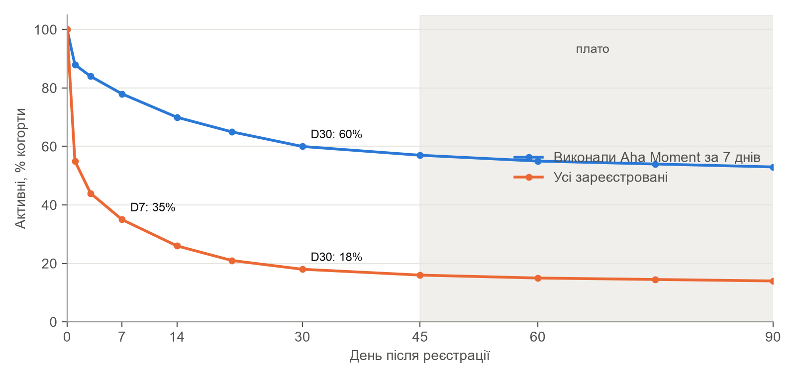
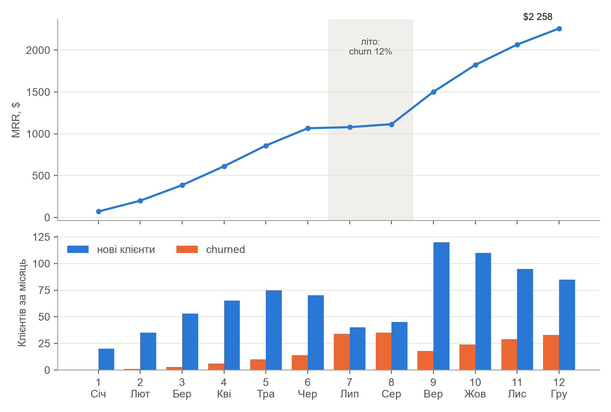
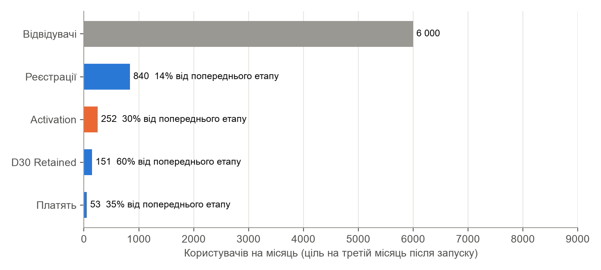
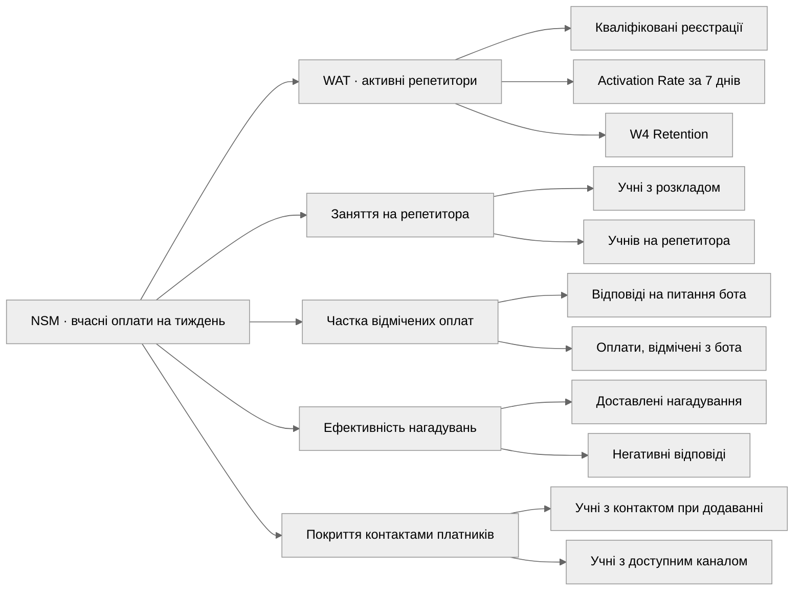
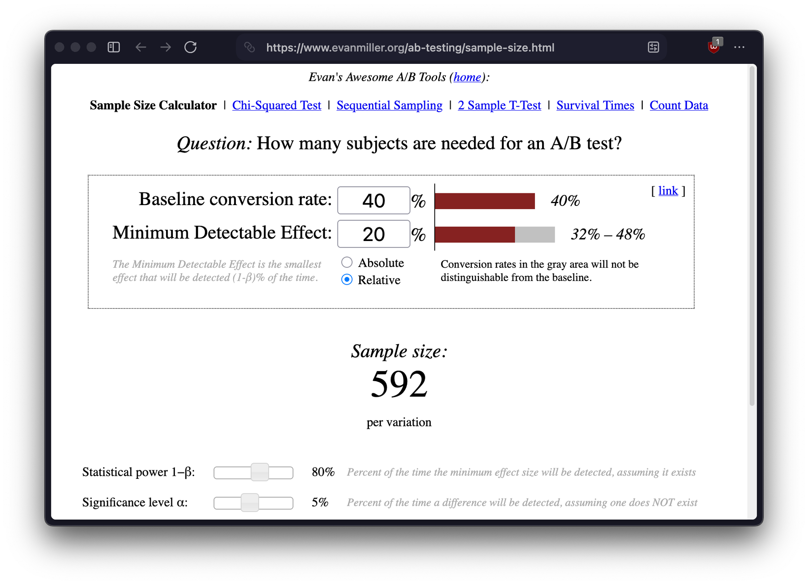

# Мета роботи

Навчитись будувати повну AARRR-воронку з конкретними метриками, визначати North Star Metric та дерево метрик, формулювати OKR та розробляти повний дизайн A/B тесту з розрахунком вибірки.

Метрики визначено для Classno – застосунку для обліку занять, оплат і нагадувань для приватних репетиторів. Вони спираються на опитування й інтерв'ю практичної роботи № 1, Job Statements практичної роботи № 2, дані Concierge MVP практичної роботи № 3 і пріоритизований беклог практичної роботи № 4. Там, де власних даних немає, використано галузеві бенчмарки. Усі суми наведено в доларах за курсом 42 грн/\$: ціна тарифу Pro 149 грн становить \$3.55 на місяць. Горизонт – перший рік після публічного запуску в січні 2027 року.

# 1. AARRR-воронка

Воронку побудовано за фреймворком Дейва Макклюра [1]. Цільові значення наведено для третього місяця після запуску, коли канали залучення вже налаштовані, а безкоштовний тариф до 5 учнів працює як вхід у продукт.

## 1.1. Acquisition – залучення

Таблиця 1 – Acquisition

| Поле | Зміст |
| ---------------------------- | ------------------------------------------------------------------------ |
| Канали залучення | 1. Telegram-спільноти репетиторів НМТ і предметних чатів – там шукають учнів і поради 79% репетиторів, які ведуть облік у месенджерах (ПР01). 2. Реферали й підпис «Classno» у кожному нагадуванні батькам і учням. 3. Таргетована реклама у Facebook та Instagram на вчителів і студентів-репетиторів. 4. Facebook-групи вчителів англійської та музики – основний канал персони Ірини. 5. Контент і SEO: статті про облік учнів і оплат для репетиторів |
| CAC по кожному каналу | Від \$7.07 (реферали) до \$50 (контент на старті); розрахунок у таблиці нижче |
| Ключова метрика Acquisition | Кількість кваліфікованих реєстрацій на місяць – нових репетиторів, які додали щонайменше трьох учнів. Проста кількість реєстрацій включає тих, хто зайшов подивитись, а три учні означають, що репетитор почав переносити свою практику в Classno |
| Ціль Acquisition на 3 місяці | 840 реєстрацій і 600 кваліфікованих реєстрацій на місяць до кінця березня 2027 року |
| Найефективніший канал | Реферали й підпис у нагадуваннях: найнижчий CAC (\$7.07), а у Concierge MVP два з трьох звернень нових репетиторів надійшли саме від людей, які побачили нагадування Classno як батьки. Репетитори довіряють колегам більше, ніж рекламі: у ПР01 Ірина назвала рекомендації основним джерелом учнів, а Аліна – Telegram-чат репетиторів |
| Конверсія відвідувач → реєстрація (ціль) | 14%: лендінг із конкретним UVP і трафіком із тематичних спільнот, а не холодним рекламним |

CAC розраховано для третього місяця: витрати на канал за місяць поділено на кількість нових платних клієнтів з нього. До витрат реферального каналу віднесено вартість безкоштовного місяця Pro для обох сторін.

Таблиця 2 – CAC за каналами (третій місяць)

<!-- gen:cac -->
| Канал | Тип | Витрати | Клієнтів | CAC | Що входить у витрати |
| ---------------------- | ------------- | ------------- | ------------ | ----------- | ----------------------------- |
| Telegram-спільноти репетиторів | Organic | \$300 | 18 | \$16.67 | Комʼюніті-менеджер на пів ставки, пости й відповіді в чатах НМТ і репетиторів |
| Реферали й підпис у нагадуваннях | Product-Led | \$99 | 14 | \$7.07 | Місяць Pro безкоштовно і тому, хто запросив, і новому клієнту |
| Таргетована реклама Facebook / Instagram | Paid | \$300 | 12 | \$25.00 | Аудиторія вчителів і студентів-репетиторів, CPC ≈ $0.25 |
| Facebook-групи вчителів | Organic | \$100 | 6 | \$16.67 | Частина часу того ж комʼюніті-менеджера |
| Контент і SEO | Organic | \$150 | 3 | \$50.00 | Статті «як вести облік учнів і оплат», окупаються через 4–6 місяців |
| Разом / середній | – | \$949 | 53 | \$17.91 | Зважений за кількістю клієнтів |
<!-- /gen:cac -->

## 1.2. Activation – активація

Таблиця 3 – Activation

| Поле | Зміст |
| ---------------------------- | ------------------------------------------------------------------------ |
| Aha Moment (гіпотеза) | Перша оплата, яку учень вніс після нагадування від Classno. Саме в цей момент продукт виконує головну роботу – повертає гроші без особистого повідомлення (Job 2 з ПР02). У Concierge MVP усі п'ятеро учасників отримали таку оплату в перший тиждень і всі пройшли тест до кінця, а цитата «вперше за рік я нікому не писала про гроші» прозвучала саме після неї. Аналогія – Aha Moment Dropbox «перший файл у папці на другому пристрої»: момент, коли сервіс уперше зробив роботу замість користувача |
| Формулювання Aha Moment | Aha Moment = коли Аліна побачить у списку боргів першу оплату, погашену після нагадування Classno, протягом 7 днів після реєстрації |
| Time to First Value (ціль) | Медіана – 4 дні. Нижня межа задана розкладом: заняття, два дні до першого нагадування і доба на оплату |
| Onboarding Completion Rate (ціль) | 75% нових репетиторів проходять три кроки онбордингу (US-007) |
| Activation Rate (ціль) | 30% реєстрацій на третьому місяці, 40% – до кінця першого року |
| Головний бар'єр до Activation | 1. У першому тижні може не виникнути боргу: учні заплатили вчасно, і нагадування просто немає кому надсилати. 2. Репетитор не вказав контакт того, хто платить (US-001), тож нагадування не доставляється. 3. Репетитор не відмічає оплати – у Concierge MVP у другому тижні регулярно звітували лише 2 з 5 учасників, а без відміток нагадування стають помилковими |
| 3 ідеї для покращення Activation | 1. На онбордингу запитувати «Хто вам зараз винен?» і відразу пропонувати надіслати перше нагадування – Aha Moment може настати вже в перший день. 2. Імпорт учнів і розкладу з Google Calendar (US-008), щоб перші заняття з'явились за хвилину. 3. Вечірнє питання бота «Хто сьогодні заплатив?» (US-014) з першого дня, щоб борги були актуальними до першого нагадування |

## 1.3. Retention – утримання

Таблиця 4 – Retention

| Поле | Зміст |
| ---------------------------- | ------------------------------------------------------------------------ |
| D1 Retention (ціль) | 55% усіх зареєстрованих – першого ж вечора бот питає про оплати за день |
| D7 Retention (ціль) | 35% усіх зареєстрованих, 78% – серед тих, хто досяг Aha Moment |
| D30 Retention (ціль) | 18% усіх зареєстрованих, 60% – серед активованих |
| DAU/MAU – Stickiness (ціль) | 30%. Бенчмарк B2B SaaS – 15–20% [2], але репетитор проводить заняття щодня, і продукт прив'язаний до цього ритму. Вищий показник забезпечує вечірнє питання бота |
| Monthly Churn Rate (ціль) | 6% серед платних клієнтів. LTV/CAC > 3 досягається при churn нижче 5.7% за поточного CAC або нижче 9.0% за CAC шостого місяця; розрахунок у підрозділі 1.5 |
| Retention Event | Репетитор відмітив заняття або оплату в застосунку чи боті. Відкриття застосунку не рахується: можна відкрити й не зробити жодної роботи, а відмітка означає, що облік ведеться саме в Classno |
| Cohort Analysis план | Щотижневі acquisition-когорти за датою реєстрації і окремо за каналом залучення; поведінкові когорти «досяг Aha Moment за 7 днів / ні» для перевірки гіпотези Aha. Інструмент – Mixpanel на безкоштовному тарифі з подіями lesson_marked, payment_marked, reminder_sent, reminder_paid |
| Аналіз Retention Curve | Ідеальна крива показана на рисунку 1. Для активованих вона виходить на плато близько 55% з шостого–восьмого тижня: хто пережив перший місяць, той переносить у Classno весь облік. Для всіх зареєстрованих плато близько 14% – різницю між кривими і має закрити онбординг |

{width=15cm}

Рисунок 1 – Цільові криві утримання для активованих і всіх зареєстрованих репетиторів

Окремо враховано сезонність: улітку частина учнів бере паузу, тому в липні й серпні churn закладено вдвічі вищим, а з вересня, з початком навчального року і підготовки до НМТ, залучення зростає.

## 1.4. Referral – рекомендація

Таблиця 5 – Referral

| Поле | Зміст |
| ---------------------------- | ------------------------------------------------------------------------ |
| Опис реферальної механіки | Репетитор ділиться персональним посиланням. Новий репетитор отримує перший місяць Pro безкоштовно, а той, хто запросив, – місяць Pro за кожного запрошеного, який почав платити. Другий потік – підпис «Classno – помічник [ім'я] з обліку занять» у нагадуваннях: їх бачать батьки, серед яких є інші вчителі |
| K-фактор | K = i × c = 2 запрошення за перші три місяці × 12% конверсії = 0.24. Вірусного зростання немає, але кожні четверо активних репетиторів приводять одного нового без витрат на рекламу |
| Viral Loop в продукті | Нагадування батькам: кожне повідомлення показує, що репетитор користується сервісом. Друге місце – запит учня на перенесення через посилання (US-017) і звіт батькам (US-026), які теж показують бренд, але вони відкладені в беклозі |
| NPS – ціль | 40 через шість місяців після запуску серед репетиторів, які користуються продуктом щонайменше чотири тижні. Опитування в боті після четвертого тижня з follow-up «Яка головна причина вашої оцінки?» [3] |
| Канали поширення | Особисті повідомлення колегам у Telegram і Viber, чати репетиторів НМТ і предметні чати, Facebook-групи вчителів, рекомендації між батьками в Viber-групах класів |

## 1.5. Revenue – дохід та unit economics

Gross Margin розраховано з прямих витрат на одного платного клієнта:

Таблиця 6 – COGS на одного платного клієнта

<!-- gen:cogs -->
| Стаття COGS | На клієнта / міс |
| ---------------------------------------------------------------------- | ------------------------------ |
| Хостинг, база даних, Telegram-бот | \$0.15 |
| Платіжний провайдер (2.75% від платежу) | \$0.10 |
| Підтримка (частка ставки на одного клієнта) | \$0.25 |
| Разом | \$0.50 |
<!-- /gen:cogs -->

Таблиця 7 – Unit Economics

<!-- gen:unit -->
| Показник | Формула | Значення | Джерело / обґрунтування |
| ------------------ | ---------------------- | --------------- | --------------------------------------------- |
| Модель монетизації | – | Freemium + підписка | Безкоштовно до 5 учнів, Pro без обмежень, Studio для міні-шкіл (ПР01) |
| Ціна підписки (ARPPU Pro) | 149 грн / 42 | \$3.55 | У діапазоні WTP 100–200 грн, який назвали 25% респондентів ПР01; Studio – \$11.88 |
| Gross Margin | (ARPU − COGS) / ARPU | 86% | COGS \$0.50 на клієнта: таблиця нижче |
| Monthly Churn Rate | – | 6% | Бенчмарк SaaS 2–5% на місяць [2]; для самозайнятих репетиторів закладено 6%, влітку 12% |
| LTV | ARPU × (1 / Churn) × GM | \$50.79 | \$3.55 × 16.7 × 0.86 |
| CAC (середній) | Витрати / нових клієнтів | \$17.91 | Зважений по п'яти каналах, таблиця CAC |
| LTV / CAC | LTV / CAC | 2.84 : 1 | Нижче цілі 3 : 1 – план нижче |
| CAC Payback Period | CAC / (ARPU × GM) | 5.9 міс | Ціль < 12 місяців виконана |
| MRR (ціль Q4) | Σ клієнтів × ціна | \$2 258 | Грудень у прогнозі нижче |
| ARR (ціль) | MRR × 12 | \$27 098 | Run-rate на кінець першого року |
<!-- /gen:unit -->

LTV/CAC 2.84 на третьому місяці нижчий за ціль 3:1. Причина – дорогі канали на старті: реклама (CAC \$25, LTV/CAC 2.0) і контент (\$50), який окупається лише через кілька місяців. План досягнення: частку рефералів підняти з 26% до 37% нових клієнтів, рекламу скоротити вдвічі і залишити лише аудиторії з CAC до \$20, а статті вже приводитимуть клієнтів без нових витрат. За цими допущеннями на шостому місяці середній CAC знижується до \$11.27, а LTV/CAC зростає до 4.51. CAC Payback 5.9 місяця вже зараз вкладається в ціль 12 місяців.

ARPU на всіх активних користувачів, включно з безкоштовними, значно нижчий за ARPPU: на третьому місяці MRR \$386 розподіляється приблизно на 600 активних репетиторів, тобто ARPU ≈ \$0.64. Тому для рішень щодо монетизації використано ARPPU, а конверсію з безкоштовного тарифу в платний відстежуємо окремо.

## 1.6. Cohort Revenue Projection

Допущення базового сценарію:

1. Нових платних клієнтів – від 20 у січні до 75 у травні; улітку 40–45, у вересні – 120, наприкінці року – 85–110 на місяць.
2. Churn – 6% на місяць, у липні й серпні – 12%.
3. Expansion – перехід міні-шкіл з Pro на Studio (\$11.88): 0–3 клієнти на місяць.
4. MRR = клієнти Pro × \$3.55 + клієнти Studio × \$11.88.

Таблиця 8 – Помісячний прогноз MRR

<!-- gen:projection -->
| Місяць | Нових клієнтів | Churned | Expansion (переходи на Studio) | Всього клієнтів | MRR | Cumul. Revenue |
| ------------- | ------------- | ------------ | -------------- | -------------- | --------------- | ------------------- |
| 1 (Січ) | 20 | 0 | 0 | 20 | \$71 | \$71 |
| 2 (Лют) | 35 | 1 | 1 | 54 | \$200 | \$271 |
| 3 (Бер) | 53 | 3 | 1 | 104 | \$386 | \$656 |
| 4 (Кві) | 65 | 6 | 2 | 163 | \$612 | \$1 268 |
| 5 (Тра) | 75 | 10 | 2 | 228 | \$859 | \$2 127 |
| 6 (Чер) | 70 | 14 | 1 | 284 | \$1 066 | \$3 193 |
| 7 (Лип) | 40 | 34 | 0 | 290 | \$1 079 | \$4 272 |
| 8 (Сер) | 45 | 35 | 1 | 300 | \$1 114 | \$5 386 |
| 9 (Вер) | 120 | 18 | 3 | 402 | \$1 501 | \$6 887 |
| 10 (Жов) | 110 | 24 | 3 | 488 | \$1 823 | \$8 710 |
| 11 (Лис) | 95 | 29 | 2 | 554 | \$2 065 | \$10 775 |
| 12 (Гру) | 85 | 33 | 2 | 606 | \$2 258 | \$13 034 |
<!-- /gen:projection -->

{width=15cm}

Рисунок 2 – Прогноз MRR і руху клієнтів на перший рік

Наприкінці року Classno має 606 платних клієнтів і MRR \$2 258, тобто ARR \$27 098. Це третина цілі SOM з практичної роботи № 1 (2 000 платних репетиторів за три роки), а літнє плато показує, що сезонність треба враховувати і в маркетингових бюджетах.

## 1.7. Вузьке місце воронки

Таблиця 9 – Воронка в числах

<!-- gen:funnel -->
| Етап воронки | Числа (ціль, 3-й місяць) | Конверсія | Відтік |
| -------------------------------------------- | -------------------- | ---------------- | -------------------- |
| 6 000 → Реєстрації (Acquisition) | 840 | 14% | 86% |
| 840 → Activation – Aha Moment за 7 днів | 252 | 30% | 70% |
| 252 → D30 Retained | 151 | 59.9% | 40.1% |
| 151 → Платять (Revenue) | 53 | 35.1% | 64.9% |
<!-- /gen:funnel -->

{width=15cm}

Рисунок 3 – Цільова воронка третього місяця

Найбільший відтік у відсотках – на переході відвідувач → реєстрація (86%), але для лендінгу з тематичного трафіку 14% конверсії – хороший результат. Відтік між платними і утриманими (65%) переважно закладений моделлю: безкоштовний тариф до 5 учнів покриває студентів-початківців, які не платитимуть. Тому вузьким місцем визначено активацію.

Таблиця 10 – Аналіз вузького місця

| Поле | Зміст |
| ---------------------------- | ------------------------------------------------------------------------ |
| Визначений bottleneck | Реєстрація → Activation: 70% нових репетиторів не отримують першу оплату після нагадування протягом 7 днів |
| Гіпотеза причини #1 | Репетитор не вказує контакт платника – нагадування нікому надсилати. Додавати контакти батьків для 15–22 учнів довго, тому цей крок відкладають |
| Гіпотеза причини #2 | Оплати не відмічаються, і через два дні нагадування блокується захистом US-012 або стає помилковим – так було в другому тижні Concierge MVP |
| Гіпотеза причини #3 | Боргу в першому тижні просто немає: учні сплатили вчасно, і продукт не встигає показати свою головну цінність |
| 3 конкретні ідеї для покращення | 1. Крок онбордингу «Хто вам зараз винен?» з першим нагадуванням у перший день. 2. Вечірнє питання бота з першого дня (US-014). 3. Додавання контакту платника одним пересланим повідомленням у бот замість ручного введення номера |
| Метрика для перевірки | Activation Rate – частка нових репетиторів, які досягли Aha Moment за 7 днів; разом із медіанним TTFV |

# 2. North Star Metric та дерево метрик

## 2.1. Вибір North Star Metric

Кандидатів оцінено за чотирма критеріями від 1 до 5 [4]: чи відображає метрика цінність для клієнта, чи корелює з виручкою, наскільки точно вимірюється і наскільки зрозуміла всій команді.

Таблиця 11 – Кандидати на NSM

| Кандидат | Цінність | Revenue | Точність | Ясність | Сума | Рішення |
| ------------------------ | ------------ | ------------ | ------------- | ------------ | --------- | -------------- |
| 1. Оплати, отримані вчасно, на тиждень | 5 | 4 | 4 | 5 | 18 | Обрано |
| 2. Тижнево активні репетитори (WAT) | 3 | 4 | 5 | 4 | 16 | Input L1 |
| 3. Учні в журналах активних репетиторів | 2 | 4 | 5 | 4 | 15 | Input L2 |

WAT вимірюється найточніше, але показує лише, що репетитор відкрив продукт, а не що отримав гроші. Кількість учнів добре корелює з виручкою (шостий учень відкриває Pro), але сама по собі не є цінністю для репетитора.

Таблиця 12 – Обґрунтування вибору NSM

| Поле | Зміст |
| ---------------------------- | ------------------------------------------------------------------------ |
| Формулювання NSM | Кількість оплат за заняття, отриманих не пізніше 3 днів після заняття, по всіх репетиторах за календарний тиждень. Одиниця – одна оплата за одне заняття або пакет |
| Чому відображає цінність для клієнта? | Безпосередньо вимірює Job 2 «отримати борг без особистого нагадування» і Job 6 «бачити готовий підсумок оплат» з ПР02. Що більше вчасних оплат, то менше грошей репетитор втрачає і то менше нагадує сам |
| Як корелює з Revenue? | Вчасні оплати зростають, коли репетитор веде в Classno більше учнів і довше: учнів понад п'ять – це перехід на Pro, а тривале використання знижує churn. До того ж кожна оплата після нагадування – це повідомлення з підписом Classno, тобто реферальний канал |
| Як технічно вимірювати? | Подія payment_marked у Mixpanel з властивостями lesson_date, paid_at, source (журнал, бот, нагадування); NSM – кількість подій з paid_at − lesson_date ≤ 3 дні за тиждень |
| Ризики та обмеження NSM | Можна «надути», якщо репетитор масово відмічає оплати заднім числом, і можна знизити, якщо він взагалі перестає відмічати: тоді метрика вимірює дисципліну звітування, а не реальні гроші. Тому поруч стоять guardrail-метрики частки помилкових нагадувань і негативних відповідей. Метрика не враховує готівку, яку репетитор забув внести |

## 2.2. Дерево метрик

На рівні Output NSM пов'язана з бізнесом так: якщо кількість вчасних оплат зростає, то зростають конверсія в Pro й утримання платних репетиторів, а отже MRR. Цільове значення – 4 000 вчасних оплат на тиждень наприкінці першого кварталу (близько 250 тижнево активних репетиторів по 16 вчасних оплат; у Concierge MVP на одного репетитора припадало в середньому 22 заняття на тиждень).

Формула розрахунку NSM через вхідні метрики:

$$NSM = WAT \cdot L \cdot \left(s + (1 - s) \cdot c \cdot r\right),$$

де $WAT$ – тижнево активні репетитори, $L$ – заняття в журналі на одного активного репетитора на тиждень, $s$ – частка занять, оплачених без нагадування, $c$ – частка учнів із контактом платника, $r$ – частка боргів, погашених протягом 3 днів після нагадування. Частку $s$ у звітності видно лише тоді, коли репетитор відмічає оплати, тож окремою вхідною метрикою стоїть частка відмічених оплат.

Рисунок 4 – Дерево метрик Classno

Таблиця 13 – Input Metrics Level 1

| Input L1 | Команда | Механізм впливу на NSM |
| ------------------------- | ------------------ | ------------------------------------------------------------------------ |
| WAT – тижнево активні репетитори | Growth і онбординг | NSM пропорційна WAT: якщо WAT зростає на 10%, NSM зростає на 10% за незмінної роботи кожного репетитора |
| Заняття в журналі на репетитора на тиждень | Продукт: журнал і розклад | Коли репетитор переносить усіх учнів, кожне нове заняття додає потенційну вчасну оплату: +10% занять – +10% NSM |
| Частка занять з оплатою, відміченою за 24 години | Продукт: Telegram-бот | Невідмічена оплата не потрапляє в NSM і робить нагадування помилковим. Зростання з 60% до 80% дає приблизно +33% видимих вчасних оплат |
| Частка боргів, погашених ≤ 3 днів після нагадування | Продукт: нагадування | Визначає, скільки боргів перетворюються на вчасні оплати: +10 п.п. ефективності – +3–4% NSM, бо прострочених оплат близько третини |
| Частка учнів з контактом платника | Продукт: онбординг | Без контакту нагадування не надсилається; зростання покриття з 70% до 90% підвищує кількість погашених після нагадування боргів на 29% |

Таблиця 14 – Input Metrics Level 2

| Input L1 | Input L2 – операційні метрики |
| ------------------------------ | ------------------------------------------------------------------------ |
| WAT | Кваліфіковані реєстрації на тиждень; Activation Rate за 7 днів; W4 Retention |
| Заняття на репетитора | Частка учнів, для яких задано постійний розклад; середня кількість учнів на активного репетитора |
| Частка відмічених оплат | Частка днів, коли репетитор відповів на вечірнє питання бота; частка оплат, відмічених з бота, а не з журналу |
| Ефективність нагадувань | Частка доставлених нагадувань (учень не заблокував бота, номер у Viber існує); частка негативних відповідей на нагадування |
| Покриття контактами | Частка учнів, доданих одразу з контактом платника; частка учнів, для яких доступний хоча б один канал (Telegram, Viber або посилання) |

Таблиця 15 – Guardrail-метрики

| Guardrail | Межа | Що захищає |
| ------------------------------ | ------------- | ------------------------------------------------------------ |
| Частка помилкових нагадувань (оплату вже внесено) | ≤ 5% | Довіру батьків: у Concierge MVP вона сягала 31% |
| Частка негативних відповідей на нагадування | ≤ 5% | Стосунки репетитора з учнями – головний страх Аліни |
| Частка учнів, які заблокували бота | ≤ 3% | Канал нагадувань: заблокований бот більше не доставить жодного |
| Monthly Churn платних клієнтів | ≤ 6% | Unit economics: LTV розраховано саме з цього значення |
| Час відкриття журналу на 3G | < 2 с | Щоденне користування між заняттями |

# 3. OKR

OKR [5] сформульовано на перший квартал після публічного запуску – Q1 2027. Базові значення взято з Concierge MVP і розрахунків AARRR; там, де продукт стартує з нуля, базове значення дорівнює нулю.

## 3.1. Company / Product OKR

Таблиця 16 – Company OKR, Q1 2027

| Поле | Зміст |
| ---------------------------- | ------------------------------------------------------------------------ |
| Objective 1 | Зробити так, щоб жодному репетитору з Classno не доводилось самому нагадувати учням про гроші |
| KR 1.1 | Досягти 4 000 вчасно отриманих оплат на тиждень (NSM) до 31 березня 2027 року, з нуля на старті |
| KR 1.2 | Підвищити Activation Rate (Aha Moment за 7 днів) з 20% до 30% у березневій когорті |
| KR 1.3 | Досягти MRR \$500 до 31 березня 2027 року |
| Objective 2 | Зростати через рекомендації репетиторів, а не через рекламу |
| KR 2.1 | Збільшити частку нових реєстрацій з реферальних посилань і підпису в нагадуваннях з 0 до 30% |
| KR 2.2 | Досягти K-фактора 0.25 серед репетиторів, зареєстрованих у січні |
| KR 2.3 | Знизити середній CAC з \$17.91 до \$13 |

Базове значення Activation Rate 20% – оцінка для SaaS із самостійним онбордингом без особистої допомоги. Ціль 30% збігається з цільовою воронкою підрозділу 1.7. Прогноз MRR на березень – \$386, тобто 77% від KR 1.3, що відповідає правилу 70% для амбітних OKR.

## 3.2. Team OKR

Team OKR сформульовано для продуктової команди з чотирьох людей, визначеної в практичній роботі № 4.

Таблиця 17 – Team OKR продуктової команди, Q1 2027

| Поле | Зміст |
| ---------------------------- | ------------------------------------------------------------------------ |
| Objective 1 | Звільнити репетитора від щоденного звітування про оплати |
| KR 1.1 | Підвищити частку занять з оплатою, відміченою протягом 24 годин, з 60% до 80% |
| KR 1.2 | Знизити частку помилкових нагадувань з 31% до 5% |
| Objective 2 | Довести кожного нового репетитора до першої повернутої оплати за перший тиждень |
| KR 2.1 | Скоротити медіанний TTFV з 6 до 4 днів |
| KR 2.2 | Підвищити Onboarding Completion Rate з 55% до 75% |
| Зв'язок Team OKR → Company OKR | Team O1 → Company O1: вищий KR 1.1 команди означає, що більше оплат відмічено вчасно, а отже зростає NSM (Company KR 1.1); менше помилкових нагадувань (KR 1.2) – менше негативних відповідей і вища довіра батьків, від якої залежить реферальний канал (Company KR 2.1). Team O2 → Company O1 і O2: коротший TTFV і вищий Onboarding Completion безпосередньо підвищують Activation Rate (Company KR 1.2), активовані репетитори частіше стають платними (Company KR 1.3) і рекомендують продукт колегам (Company KR 2.2) |

Базові значення Team OKR взято з Concierge MVP: у другому тижні оплати відмічались у середньому 4.2 дня з 7 (60%), помилковими були 31% нагадувань, а перша оплата після нагадування надходила в середньому на п'ятий–шостий день після старту. Onboarding Completion 55% – оцінка до першого юзабіліті-тесту US-007.

## 3.3. Перевірка якості OKR

Таблиця 18 – Перевірка Company KR

| Критерій | KR 1.1 | KR 1.2 | KR 1.3 | KR 2.1 | KR 2.2 | KR 2.3 |
| ---------------------- | ------------- | ------------- | ------------- | ------------- | ------------- | ------------- |
| Містить конкретне число | Так | Так | Так | Так | Так | Так |
| Описує результат, а не задачу | Так | Так | Так | Так | Так | Так |
| Вимірюється інструментом | Mixpanel | Mixpanel | Платежі | UTM | Коди | Бюджет |
| Амбітний (≈70%) | Так | Так | Так, прогноз 77% | Так | Так | Так |
| Прив'язаний до Objective | O1 | O1 | O1 | O2 | O2 | O2 |
| Зв'язок з AARRR або NSM | NSM | Activation | Revenue | Referral | Referral | CAC |

Джерела даних для KR: «Платежі» – звіт платіжного провайдера, «UTM» – мітки джерела трафіку в Mixpanel, «Коди» – реферальні коди в базі Classno, «Бюджет» – облік маркетингових витрат за каналами.

Таблиця 19 – Перевірка Team KR

| Критерій | KR 1.1 | KR 1.2 | KR 2.1 | KR 2.2 |
| ---------------------------- | -------- | -------- | -------- | -------- |
| Містить конкретне число | Так | Так | Так | Так |
| Описує результат, а не задачу | Так | Так | Так | Так |
| Вимірюється інструментом | Mixpanel | Лог бота | Mixpanel | Mixpanel |
| Амбітний (≈70%) | Так | Так | Так | Так |
| Прив'язаний до Objective | O1 | O1 | O2 | O2 |
| Зв'язок з AARRR або NSM | NSM (Input L1) | Guardrail | Activation | Activation |

Жоден KR не сформульовано як задачу: замість «запустити вечірнє питання бота» KR 1.1 команди вимірює, наскільки частіше оплати відмічаються вчасно, а сам бот – лише спосіб цього досягти.

# 4. Дизайн A/B тесту

## 4.1. Повний дизайн тесту

Для тесту обрано гіпотезу HYP-004 у формулюванні з фінального рішення практичної роботи № 3 і Story US-014 з беклогу практичної роботи № 4. У RICE вона має Confidence лише 50%, а від неї залежить найважливіша вхідна метрика дерева – частка відмічених оплат. Зміна одна і реалізується за один спринт.

Таблиця 20 – Дизайн A/B тесту «Вечірнє питання бота»

| Поле | Зміст |
| ---------------------------- | ------------------------------------------------------------------------ |
| Назва тесту | Вечірнє питання бота «Хто сьогодні заплатив?» |
| Гіпотеза | Якщо ми додамо щовечірнє питання бота «Хто сьогодні заплатив?» зі списком учнів дня і кнопками, то частка нових репетиторів, які відмічають оплати щонайменше 5 днів з 7 у другому тижні, зросте на 20% відносно (з 40% до 48%), тому що відмітка займатиме кілька секунд і не вимагатиме пам'ятати про журнал наприкінці дня |
| Версія A – Control | Поточний стан: репетитор відмічає оплати сам у журналі застосунку; бот надсилає лише підсумок тижня і нагадування учням |
| Версія B – Treatment | Те саме плюс одне повідомлення бота о 20:00 у дні, коли були заняття: список учнів дня з кнопками «Заплатив» і «Ніхто». Більше нічого не змінюється, щоб ефект можна було приписати саме питанню |
| Primary Metric | Частка нових репетиторів, які відмітили оплати щонайменше в 5 з 7 днів другого тижня після реєстрації |
| Baseline CR | 40%: у другому тижні Concierge MVP так звітували 2 з 5 репетиторів. Після запуску baseline уточнюється з контрольної групи |
| MDE | 20% відносно – 8 п.п. Менший ефект не виправдовує щоденне повідомлення, яке може дратувати |
| Рівень значущості (α) | 0.05 |
| Статистична потужність | 80% |
| Розмір вибірки | 592 репетитори в кожній групі, 1 184 разом (розрахунок у підрозділі 4.2) |
| Тривалість тесту | 8 тижнів набору і 14 днів спостереження за останньою когортою – 70 днів |
| Secondary Metrics | Частка боргів, погашених ≤ 3 днів після нагадування; W4 Retention; медіанний час від заняття до відмітки оплати |
| Guardrail Metrics | Частка репетиторів, які вимкнули повідомлення бота (≤ 5%); частка помилкових нагадувань учням (не вище, ніж у контролі); Monthly Churn у першій платній когорті |
| Механізм рандомізації | За User ID репетитора: хеш ID за модулем 100, 0–49 – A, 50–99 – B. У тест потрапляють лише нові репетитори з першим заняттям у журналі. Перші 3 дні тест іде на 20% нових репетиторів для перевірки помилок, далі – на всіх |
| Критерії дострокової зупинки | Лише на захист: якщо в групі B понад 10% репетиторів вимкнули повідомлення бота, частка помилкових нагадувань зросла більш ніж на 5 п.п. або виявлено Sample Ratio Mismatch понад ±5%. За успіх тест достроково не зупиняється |
| Сценарій 1: B виграє | Вмикаємо питання для всіх нових репетиторів через feature flag, а через тиждень – для наявних. Відповідальні – Product Owner і розробник бота. Наступний тест – час питання: 20:00 проти «через годину після останнього заняття» |
| Сценарій 2: A виграє | Вечірнє повідомлення заважає більше, ніж допомагає. Переглядаємо механізм відмітки: наступна гіпотеза – пересилання сповіщень банку боту (US-016), яке не вимагає щоденної дії; Confidence US-014 у RICE знижуємо до 20% |
| Сценарій 3: Inconclusive | Вибірку не збільшуємо: ефект менше 8 п.п. не вартий щоденного повідомлення. Проводимо 5 інтерв'ю з репетиторами групи B, щоб зрозуміти, чому не відповідали на питання, і переформульовуємо гіпотезу |

## 4.2. Розрахунок вибірки

Розмір вибірки для порівняння двох частк обчислено за формулою [6]:

$$n = \frac{\left(z_{1-\alpha/2}\sqrt{2\bar{p}(1-\bar{p})} + z_{1-\beta}\sqrt{p_1(1-p_1) + p_2(1-p_2)}\right)^2}{(p_2 - p_1)^2},$$

де $p_1 = 0.40$, $p_2 = 0.48$, $\bar{p} = 0.44$, $z_{1-\alpha/2} = 1.96$, $z_{1-\beta} = 0.84$. За цією формулою $n = 604$, спрощена формула $n = 2 (z_{1-\alpha/2} + z_{1-\beta})^2 p(1-p) / (MDE \cdot p)^2$ дає 589.

Калькулятор Evan Miller [7] з тими самими параметрами – Baseline 40%, MDE 20% відносно, α = 0.05, Power = 80% – дає 592 на групу (рисунок 5). Різниця з формулою в межах 2% пояснюється іншим способом наближення дисперсії; для плану тесту взято значення калькулятора.

Таблиця 21 – Розрахунок вибірки і тривалості

<!-- gen:ab_calc -->
| Параметр | Значення |
| ------------------------------------------------------- | --------------------------------------------- |
| Baseline CR (p) | 40% |
| MDE (відносний) | 20% |
| Absolute MDE | 40% × 20% = 8% (8 п.п.) |
| Очікуване значення B | 48% |
| α | 0.05 |
| Power | 80% |
| N у кожній групі (калькулятор) | 592 |
| Нових репетиторів на день, з них з першим заняттям | 28, 24 |
| Трафік на групу (50/50) | 24 / 2 ≈ 11.9 на день |
| Набір вибірки | 592 / 11.9 ≈ 50 днів → 8 тижнів |
| Спостереження за останньою когортою | 14 днів |
| Тривалість тесту | 8 × 7 + 14 = 70 днів |
<!-- /gen:ab_calc -->

{width=15cm}

Рисунок 5 – Розрахунок вибірки в калькуляторі Evan Miller

Нових репетиторів на третьому місяці – 840 на місяць, тобто 28 на день, з них близько 85% додають перше заняття і потрапляють у тест. Тривалість понад 14 днів обумовлена малим трафіком; щоб скоротити тест, довелося б збільшити MDE, а ефект 30% для одного повідомлення бота нереалістичний.

Додаткові перевірки:

1. Sample Ratio Mismatch. Щодня порівнюється кількість репетиторів у групах; відхилення понад ±5% від 50/50 зупиняє тест як технічну помилку.
2. Novelty Effect. У тест потрапляють лише нові репетитори, тож ефекту новизни для наявних користувачів немає; для них зміна вмикається тільки після тесту.
3. Сезонність. Тест триває 10 тижнів і охоплює всі дні тижня; запускати його треба до червня, щоб не захопити літній спад.
4. Interference. Учні одного репетитора не бачать повідомлень іншого, тож групи не перетинаються. Єдиний ризик – репетитори з однієї міні-школи на тарифі Studio, тому рандомізація для Studio відбувається за акаунтом школи, а не за окремим викладачем.

# Висновки

Метрики переводять пріоритети беклогу з практичної роботи № 4 з рівня оцінок на рівень конкретних цифр, які можна відстежувати.

1. Вузьким місцем воронки виявилась активація: 70% нових репетиторів не досягають першої оплати після нагадування за тиждень. Тому серед Stories MVP першими мають іти ті, що скорочують TTFV, – онбординг (US-007), додавання учня з контактом платника (US-001) і вечірнє питання бота (US-014). Імпорт з Google Calendar (US-008), який у ПР04 був у буфері MVP, варто підняти вище: він прямо впливає на Activation.
2. North Star Metric «вчасні оплати на тиждень» підтверджує вибір ядра MVP: усі п'ять вхідних метрик дерева відповідають Stories, які в ПР04 отримали рішення MVP. Самостійне перенесення занять (US-017) на NSM не впливає, тож його місце в Backlog обґрунтоване вдруге.
3. Unit economics показали, що реферальний канал є не лише способом зростання, а й умовою окупності: з CAC \$17.91 LTV/CAC лише 2.84, а з більшою часткою рефералів – 4.51. Через це Stories, які показують бренд іншим (підпис у нагадуваннях, нагадування посиланням US-025), отримують додаткову цінність, якої не було в RICE.
4. A/B тест вечірнього питання бота потребує 1 184 нових репетиторів і 70 днів. Його треба запустити в першому кварталі, щоб результат був до літа: від нього залежить, чи лишиться US-014 у MVP, чи ручну відмітку замінить пересилання сповіщень банку (US-016).

# Список джерел

1. McClure D. Startup Metrics for Pirates: AARRR! 500 Startups. 2007. URL: https://www.slideshare.net/dmc500hats/startup-metrics-for-pirates-long-version (дата звернення: 18.10.2026).
2. Croll A., Yoskovitz B. Lean Analytics: Use Data to Build a Better Startup Faster. Sebastopol : O'Reilly Media, 2013. 440 p.
3. Reichheld F. F. The One Number You Need to Grow. Harvard Business Review. 2003. December. URL: https://hbr.org/2003/12/the-one-number-you-need-to-grow (дата звернення: 18.10.2026).
4. The North Star Playbook. Amplitude. URL: https://amplitude.com/books/north-star (дата звернення: 18.10.2026).
5. Doerr J. Measure What Matters: How Google, Bono, and the Gates Foundation Rock the World with OKRs. New York : Portfolio, 2018. 320 p.
6. Kohavi R., Tang D., Xu Y. Trustworthy Online Controlled Experiments: A Practical Guide to A/B Testing. Cambridge : Cambridge University Press, 2020. 290 p.
7. Miller E. Sample Size Calculator. Evan's Awesome A/B Tools. URL: https://www.evanmiller.org/ab-testing/sample-size.html (дата звернення: 18.10.2026).
